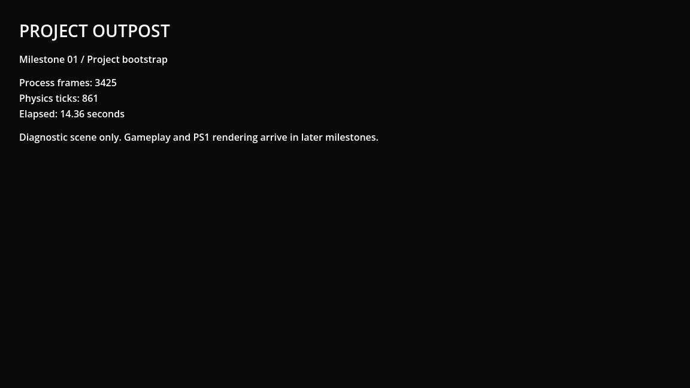

# M01 verification — runnable skeleton and local Git baseline

Verified 13 September 2026 using the open Godot 4.7.2 editor at this workspace.
Godot AI session: game-project@8d2dbd0b873db8e3.

## Implementation

- project.godot names Project Outpost and runs res://scenes/main.tscn.
- Main hosts scenes/diagnostics/bootstrap.tscn and scripts/core/game_root.gd.
- The diagnostic displays live process frames, physics ticks and elapsed seconds.
  It uses text and a background color, with no texture references or gameplay art.
- The existing Godot AI editor plugin and runtime helper remain enabled.
- Git was initialized on main with origin set to the supplied GitHub URL. Source
  assets and the existing addon form the initial baseline; generated caches,
  local builds, secrets files and tooling caches are ignored.

## Runtime evidence

1. filesystem_manage(scan) completed; scene_open switched to main.tscn.
2. project_run(mode="main") reported helper_live=true, status=live, no current
   run errors and no retained/recent errors.
3. MCP game_eval sampled counters, awaited 0.5 seconds and sampled again:
   - Process frames: 3261 -> 3382.
   - Physics ticks: 820 -> 851.
   - Elapsed seconds: 13.681481 -> 14.185648.
   - Result: advancing=true; exactly one Main instance; expected main scene path.
   - On-screen label matched the second sample's state.
4. editor_screenshot(source="game") returned a fresh 1152x648 PNG at frame 3425.
   Visually inspected: title, milestone label and all counters are legible and
   unclipped; diagnostic scope is explicit. No missing-resource display appeared.
5. project_manage(stop) stopped the first run. A new project_run(mode="main")
   produced run token 2, helper_live=true and no reported run errors.
6. The second run reported 42 frames, 13 physics ticks and 0.227594 seconds,
   confirming fresh runtime state rather than continuation of the old instance.
   Main instance count remained one. A later editor_state confirmed game live and
   game_capture_ready=true.

Raw counter/restart/capture results: [runtime_results.json](M01/runtime_results.json).

## Git review and limits

- Reviewed the staged project configuration, new scenes/script and ignore rules.
- git diff --cached --check over project-owned files passed.
- The whole initial baseline has pre-existing whitespace findings in
  Textures/SBS - Horror Texture Pack 256x256/License.txt and two files in the
  supplied Godot AI addon. Those vendor files were preserved.
- git ls-files .godot returned no tracked cache files.
- The saved PNG decoded to the tool-reported 1152x648 dimensions.
- No push or external repository mutation was performed.
- This verifies only M01. Player movement, gameplay, PS1 rendering, GUT and
  export/CI validation belong to later milestones and are not claimed complete.

Commit message: chore: establish runnable project and local git baseline
