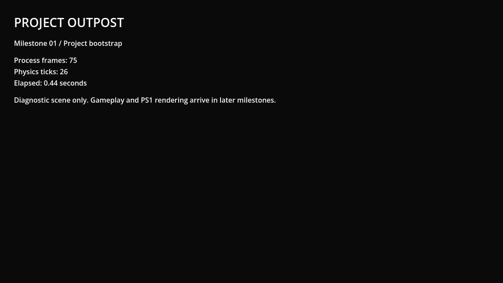

# M02 — test tooling and export pipeline

Verified 13 September 2026. Pinned GUT 9.7.1 and Phantom Camera 0.11.0.3
are installed/enabled. Release origins and exact commits are in TOOLING.md.

- GUT bootstrap test: 1/1 passed, 4 assertions, exit 0.
- Temporary intentional assertion failure: 0/1 passed, exit 1. Probe removed.
- The verification script also rejects parser errors and missing GUT summaries;
  a zero process exit code alone is insufficient (observed during class import).
- Editor restarted after new addon registration to remove stale class state.
  Fresh MCP session game-project@461c99ddae677c9a reported both addons registered,
  camera manager present, no editor errors and live advancing bootstrap.
- Fresh 1152x648 MCP screenshot inspected; no clipping or missing resources.
- Official 4.7.2 export template SHA512 verified:
  ca4d71c4d7b81dfc15d1a98baa07534aa95b03fdda78a0075b06672e1648d2e5f40980c9adc28d23e1b92e732ee7bf3461997aa804af74ec2fcd7a93ccb84079
- Windows release exported to builds/windows/ProjectOutpost.exe with its PCK.
  Runtime probe returned OUTPOST_EXPORT_VERIFIED: process=65 physics=30, exit 0.
  The probe also asserts PhantomCameraManager exists and the MCP helper does not.
- Removed unused Phantom Camera examples/editor content from export after their
  serialization warnings appeared. Subsequent pack/export had no such warnings.
- A headless packed-resource run also passed (process=62, physics=30).
- Workflow installs checksum-verified matching engine/templates, invokes the same
  verification script and uploads Windows output on push/PR/manual dispatch.
  Hosted CI has not run because no push was requested or performed.

Evidence: [runtime inspection](M02/runtime.json),
[intentional failure](M02/intentional_failure.txt),
[initial import/test](M02/import_and_test.txt).

