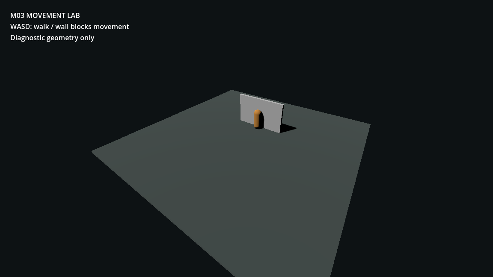

# M03 — grounded player movement

- Walk speed 2.6 m/s, acceleration 16 m/s², deceleration 20 m/s².
- Physical WASD bindings; grounded capsule collision; no jump/sprint additions.
- GUT: 4 total tests passed, 13 assertions. Movement-specific checks cover
  diagonal normalization, grounding, wall blocking, stopping, and comparable
  travel at 30/120 physics ticks per second.
- MCP custom scene run succeeded with no startup errors. Live forward input
  moved the player from (0, 0.001, 2) to (0, 0.001, -1.597777), stopping at
  the wall. Grounded=true; speed after release=0.
- Fresh runtime screenshot inspected: capsule stands on floor against the wall,
  with no penetration. This explicitly labeled diagnostic is not final art.

[Runtime values](M03/runtime.json)
