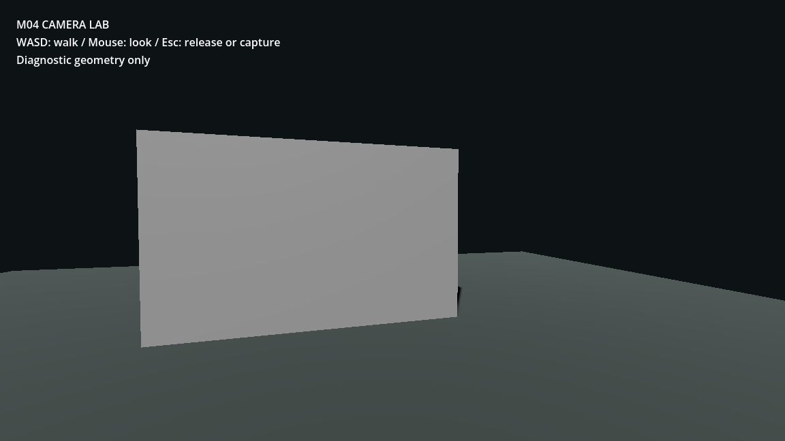

# M04 — first-person camera and input capture

- Head height 1.55m, FOV 75°, mouse sensitivity 0.0025 radians/pixel;
  vertical look limited to ±80°. These are exposed tuning choices.
- InputContext separates WALK, TERMINAL and MENU; non-walk states immediately
  stop horizontal movement and suppress mouse look. No head bob/shake added.
- GUT: 6/6 tests, 21 assertions. Camera tests cover yaw/pitch limits,
  movement/look blocking in both UI contexts and resumed walking.
- Live MCP injected mouse motion through Input.parse_input_event. Yaw changed
  0 to -0.25 and pitch to -0.025. Active camera is the player's Head/Camera.
- Actual Escape key events matched the binding; first press released the mouse
  (mode 0, MENU), second recaptured it (mode 2, WALK).
- Fresh first-person screenshot visually checked; no body clipping or unintended
  third-person camera. Scene remains an explicit untextured diagnostic.
- Editor was restarted after startup setting changes so live/disk input maps agree.

[Runtime inspection](M04/runtime.json)
