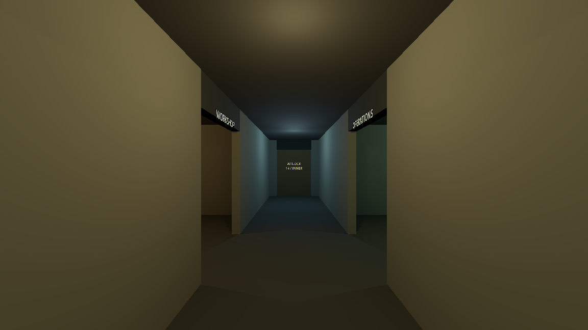
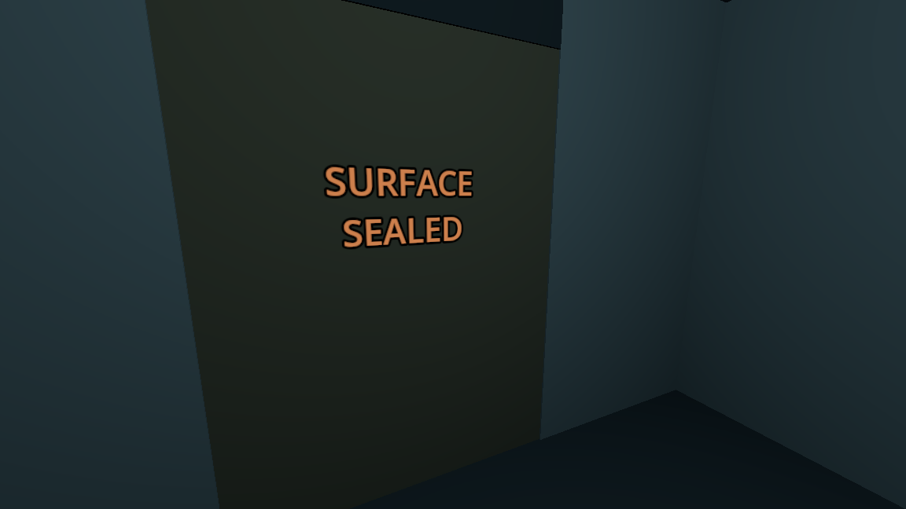

# M05 — bunker layout and airlock

- Main now opens the actual walkable bunker instead of the bootstrap display.
- Measured layout in docs/design/BUNKER_LAYOUT.md: four functions connected by
  a 2.6m passage, 2.8m ceiling and openings wider/taller than the player capsule.
- GUT: 10/10 tests, 53 assertions. Traversal drives real movement through command,
  workshop, life support and the opened airlock. Every waypoint stays grounded.
- Door checks reject unauthorized outer opening and simultaneous/cycling opens;
  they assert actual animated door positions after open/close cycles.
- Live MCP main run and fresh screenshot show the hallway, clear openings and
  labeled interlocked inner door. Lighting differentiates the four areas.
- Live movement into the airlock confirms that the closed inner door blocks the
  player, opening it allows passage, and the outer door remains closed.
- The first live contact test exposed platform carry dragging the player into
  the jamb. Disabled automatic platform following for the grounded operator;
  added a regression that opens the door while the capsule touches it. The
  repeated live test held X=0 through the slide, then walked to Z=-7.51 inside.
- No startup/editor errors reported. Materials are explicitly the flat greybox
  stage; PS1 rendering and the verified PSX asset pass follow in M06–M09.

[Runtime measurements](M05/runtime.json)
