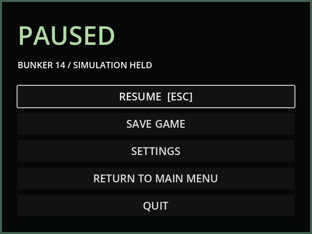

# M13a — Persistent settings and key rebinding

26 September 2026. Godot 4.7.2, Forward+ / D3D12.

Settings are available from both main and pause menus. Master, effects and
ambience gains, mouse sensitivity, and five physical gameplay keys apply
immediately and persist separately from campaign saves in
`user://outpost/settings.json`. Restore Defaults resets all preferences.
Duplicate bindings swap assignments; Escape remains reserved for navigation.
Interaction prompts follow the selected use key, including after a paused rebind.

Validation:

- GUT: 26 tests, 148 assertions. New tests cover disk round trips, rejected
  malformed preferences without partial application, duplicate swapping,
  defaults, physical InputMap events, AudioServer gain/mute, both menu entry
  points, live camera sensitivity, interaction text and Escape capture while
  simulation remains paused. Tests use isolated preference paths.
- Direct rendered engine run: settings and pause captured at 640×480 and
  visually inspected; all controls fit without clipping.
- Windows release export and headless runtime probe pass.
- Godot AI MCP tools were not exposed in this session. These are direct engine
  checks, not a claim of live editor MCP verification.
- Audio bus values are verified; audible mix review awaits actual gameplay
  sound implementation in M41.

