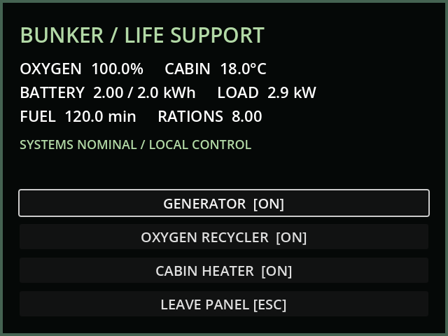
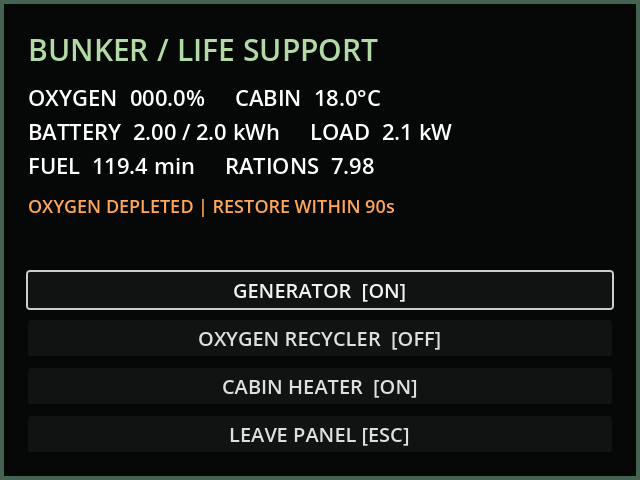
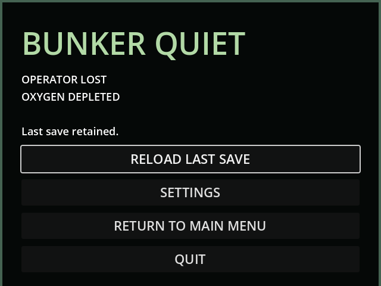

# M13b — Bunker life support

Verified 10 October 2026, Godot 4.7.2 / Forward+ D3D12. Live editor connection
`game-project@666d1a7e26949c8c`, Godot AI addon/server 4.2.3.

The life-support and power breaker interactions now open operating instruments.
Generator, recycler and heater controls change real resource use. Warnings lead
to the user-selected grace period and death/reload behavior. Rates are provisional
and documented in [LIFE_SUPPORT.md](../design/LIFE_SUPPORT.md).

Validation:

- GUT: 34 tests, 229 assertions, all pass. New coverage measures energy/fuel/ration
  conservation, fractional fuel and battery exhaustion, circuit loads, oxygen and
  heat loss, timestep partitioning, each lethal condition, recovery before death,
  pause, panel readings/buttons, save round trips, old-save migration, persisted
  grace and blackout state, rejected dead saves, Escape/resume lock, settings
  return after death and the no-save new-run path.
- Live MCP launched the main scene with `helper_live=true`. Runtime evaluation
  opened the physical breaker interaction and confirmed its readings match the
  model. Fresh MCP screenshots inspected at 640×480 without clipping.
- Injected oxygen depletion with 30 seconds elapsed: model and panel both read
  `OXYGEN DEPLETED | RESTORE WITHIN 90s`. Restoring the recycler cleared the timer.
- A second unrecovered depletion reached death at 120 seconds. Live checks
  confirmed pause, blocked walking, enabled reload, rejected saving and unchanged
  committed save. The actual Reload Last Save button restored oxygen to 100,
  cleared death/input lock and resumed physics. A subsequent pause held all
  life-support values.
- Windows release export passes both headless and rendered runtime probes.

Live checks used `user://tests/live_m13b/save.json`, separate from the player slot.
Existing PSX house breaker models are reused; no new texture or placeholder path
was added. The user's stable UVs and higher-resolution rendering remain in effect.
Audible alarms and final pacing require later audio and balancing milestones.

