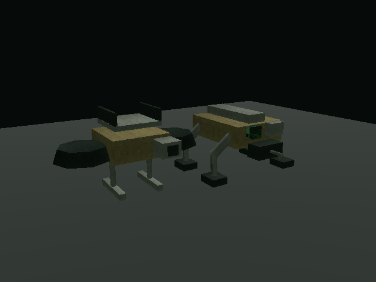
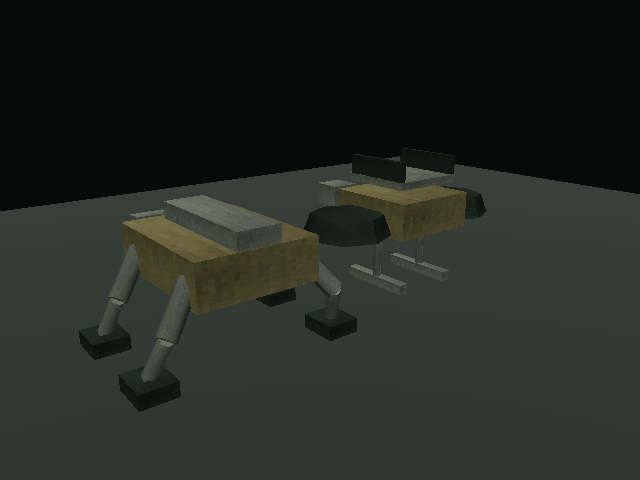
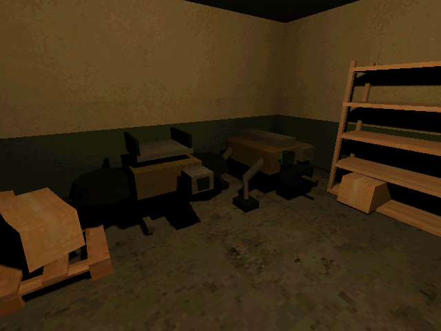

# M14 — Opening drones and sockets

10 October 2026. Godot 4.7.2, live Godot AI 4.3.0.

Custom hulls rendered from front and rear before first bunker placement. Both use
verified PSX 64px metal/radio textures through the stable surface shader. Forms
and loadouts are recorded in [OPENING_DRONES.md](../design/OPENING_DRONES.md).

Validation: 38 GUT tests / 260 assertions pass; Windows release export and runtime
probe pass. Four new tests check exact opening pair, no Mule camera, socket type,
occupied-slot/condition/payload rejection, power/mass accounting, identity and
condition serialization, duplicate-ID rejection and old-save migration.

Live MCP runs reviewed both models and then the bunker. Runtime checks reported
exactly two machines and the intended sensor sets. In an isolated save slot, sonar
was removed from Mule, CCD fitted at 68% condition, then saved and reloaded; identity,
CCD and condition were preserved. No default player save was changed. Existing
bunker movement, clearance, interlock and interaction tests still pass.

