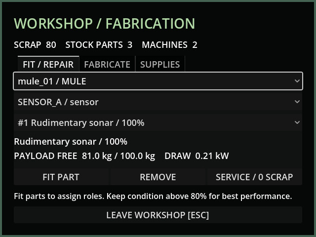
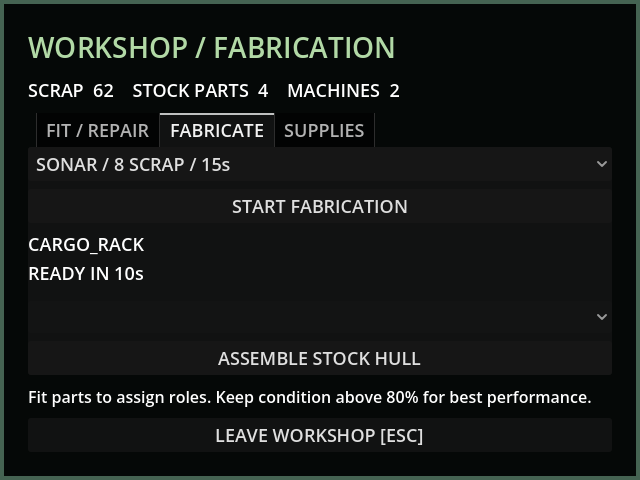
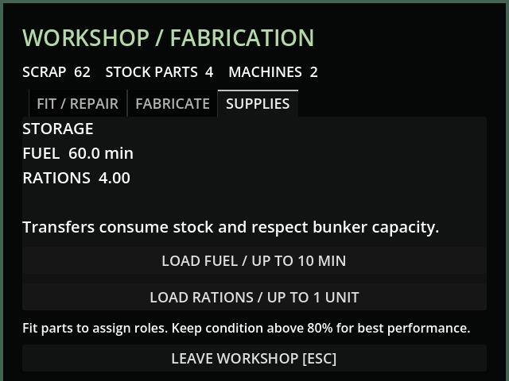

# M15 — Workshop fitting, repair and fabrication

10 October 2026. Godot 4.7.2; live Godot AI 4.3.0 against this workspace.

44 GUT tests / 316 assertions pass, with no orphan warning after queued-world
cleanup. Six new scenarios exercise stock/condition conservation, invalid fitting,
repair charging, completion once, insufficient funds, blackout/partial power,
pause, collision-free hull assembly, tank limits and invalid save payloads.
Windows release export and headless runtime probe also pass.

Live MCP operated the fabrication button in an isolated save slot. A retrace job
debited 12 scrap; saving after 6.5s and Continue preserved 23.5s remaining and
the payment. Completion produced one stock part; repeated advance produced none.
Rendered fitting, fabrication and supplies panels fit the 640×480 framebuffer.
Screenshots reported stale_frame=false. Default campaign save was untouched.

