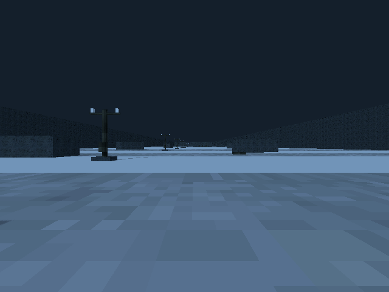
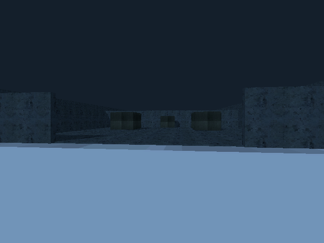

# M16 — Southern surface and pylon route

10 October 2026. Live Godot AI 4.3.0 ran the isolated surface review. Both frames
were fresh and inspected at drone height before main-scene integration. Texture
validation caught and corrected mipmaps on the newly used concrete import.

The layout test checks inside/outside bounds, the substation's contested band,
clear centre-lane physics ray, collidable east bound, 35m spacing and dead pylons.
Full-suite result is recorded in BUILD_LOG.md. No clean sensor image is exposed
through a gameplay terminal in this milestone.

