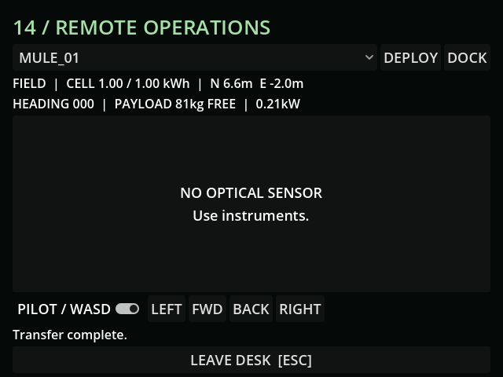

# M17 — Deployment and remote input ownership

47 tests / 355 assertions pass. Tests cover timed single transfer, door interlock,
distant-dock rejection, local recall, selected-machine ownership, operator staying
put, switching/exit stopping input and actual surface boundary collision.

Live MCP deployed Mule, applied one second of throttle and measured z=-16.41
while the operator stayed at z=4.8. The desk screenshot is fresh and contains
instruments only. Abstract loader transport is documented in REMOTE_CONTROL.md.
The subsequent save-validator guard is checked by the full suite in M18.

