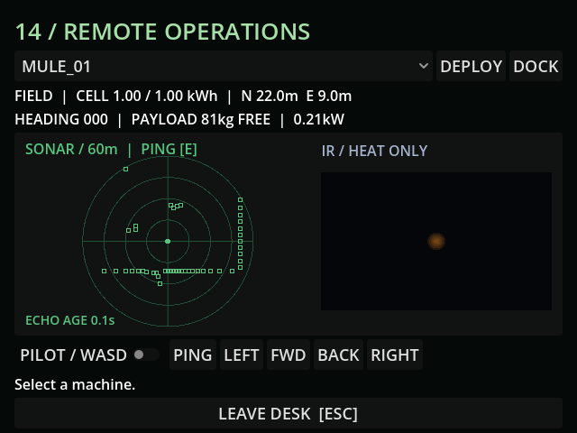

# M18 — Sonar and IR

Live MCP at (9,-32) returned 45 sonar echoes and one warm vent. The fresh screenshot
shows outline returns and an ambiguous heat blob, with no clean world image.
Tests verify real physics returns, ping cooldown, stale-map behavior/expiry,
hardware gating, no Camera3D on the blind Mule, heat-only payloads and concrete
occlusion. Full suite result is in BUILD_LOG.md; current run has no script errors.

