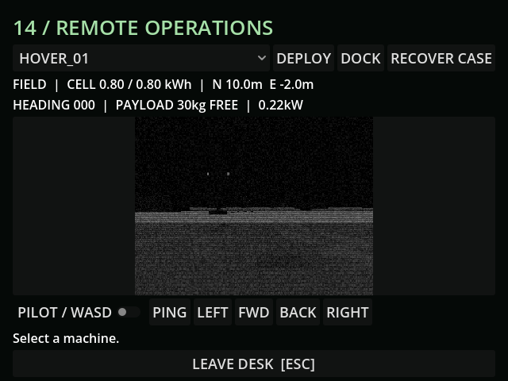
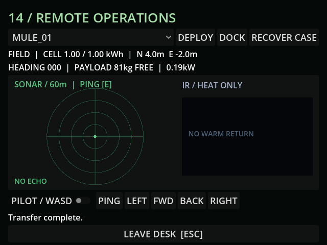

# M19 — CCD and camera discovery

51 tests / 386 assertions pass. Windows export/runtime probe pass. Tests exercise
physical recovery range, once-only pickup/delivery, carried save round trip,
condition, fitting as the capability trigger and no fabrication unlock.

Live MCP measured 30 CCD ticks against 120 physics ticks in two seconds. With
the camera rotating, raw rendered viewport hashes changed three times over 12
physics/draw samples, confirming actual optical frame holds rather than a label.
Rendered feed is monochrome with scanlines/static and limited darkness visibility.
Live recovery→dock→workshop fit succeeded; a fresh screenshot shows Mule's new CCD.

