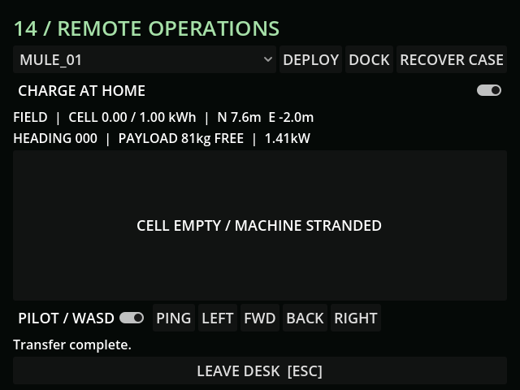

# M20 — Batteries and charging

54 tests / 400 assertions pass. Three new tests check stationary/travel/load draw,
actual zero-cell movement stop, sensor shutdown, grid-backed charging despite stale
supply fractions, charger toggles, capacity clamp and saved stranding.

Live MCP started a 0.0015kWh Mule, drove to z=-17.56 and confirmed its cell reached
zero and position held during a further 0.5s of throttle. The fresh rendered desk
shows the stranded state. A subsequent local dock/charge probe checks blackout
versus delivered generator energy. UI shows actual field draw and hull capacity.

