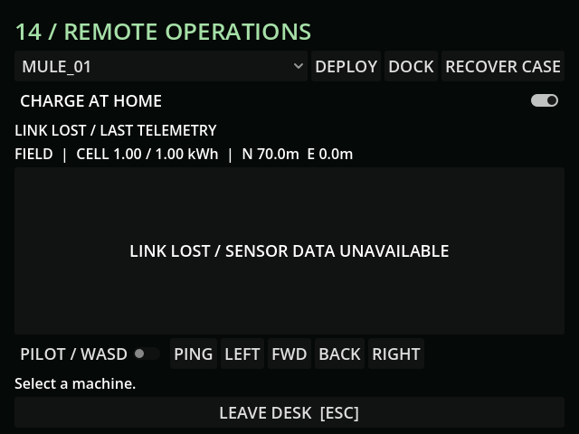

# M21 — Radio range, occlusion and delayed packets

56 tests / 413 assertions pass. Tests compare clear/concrete-obscured paths,
range severance, seeded dropout timing/save/RNG restoration, delayed leases,
expiry and cancellation of queued movement/actions across reconnection.

Live MCP measured 58% signal at z=-80 and zero at z=-200. The desk kept its last
N70m telemetry, did not reveal N190m, hid sensors, and had zero pending input.
Fresh screenshot inspected. Rendering uses the existing CCD noise shader.

