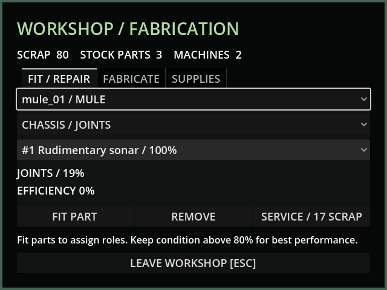

# M22 — Wear, efficiencies and faults

58 tests / 434 assertions pass; updated sonar checks also pass. Boundary tests
cover exactly 20/80 and adjacent values. Seeded 1000-cycle samples fall within
the 50%/10% tolerances and produce zero high-band condition faults. Tests exercise
distance/load wear, real module gating, paid home repair and fault persistence.

Live MCP measured fresh joints at 3.6m/s, bottom-band joints at 1.05m/s and jammed
joints at zero. Docked workshop UI correctly quoted 17 scrap after additional
fractional wear below 20. Service consumed exactly 17, restored 100% and cleared
the fault. Fresh screenshot inspected; CCD efficiency shader has no runtime error.

