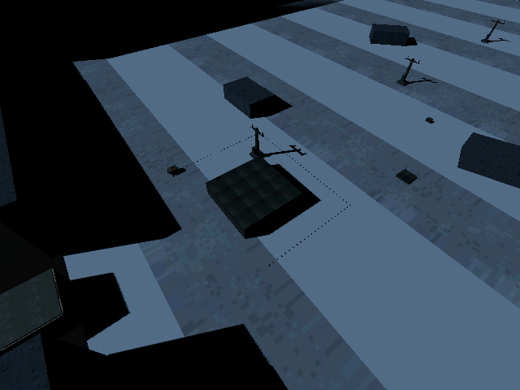

# M23 — Freeze and breadcrumb retrace

Full suite: 60 tests / 445 assertions pass; an extended targeted round-trip check
adds three passing assertions. Tests exercise immediate freeze, physical return,
battery stop, blocked-path stop and restoration of points/cursor. The expanded
case restores the full campaign during return and observes continued movement.

Live MCP fabricated/paid/fitted a retrace module and physically drove three legs
around an 8m obstacle. It recorded 84 points. After blackout at (7.89,-26.09),
the hull returned to (7.72,-38.25) in six seconds, following the back of the
obstacle rather than cutting across it, and eventually reached (-10,-24.24).
The first diagnostic attempt ran into a pylon and exceeded the bridge's 8s eval
limit; playback was relaunched and the successful route used shorter evals.

The fresh overhead frame below is an explicitly temporary diagnostic camera with
recorded-step markers. It is not a view available to the blind drone/player.
Current-run logs have no script errors.

