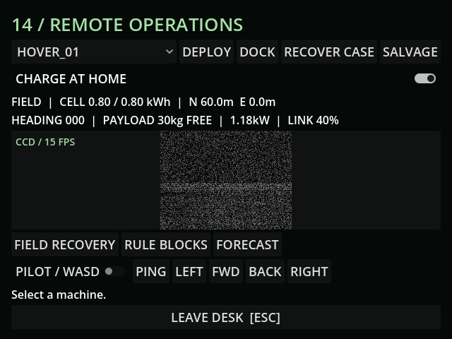

# M27c — Ion smog

Verified 10 October 2026 against the live Godot 4.7.2 MCP editor/runtime.

- Four weather tests / 34 assertions pass: 60% radio range, 1.5-second extra command latency, IR retained, exterior fog isolated from the sealed bunker, and clean transition restoration.
- Live hover at N105 loses contact in smog (quality 0), returns to quality 0.361646 in overcast, and restoring the smog snapshot reapplies range 0.6.
- Fresh CCD capture shows 65% optical interference added to ordinary signal noise. Exterior camera range is 35m during smog. Current game log contains no errors.
- Mutant sensory multiplier 0.5 is exposed; actual creature integration belongs to M29.

