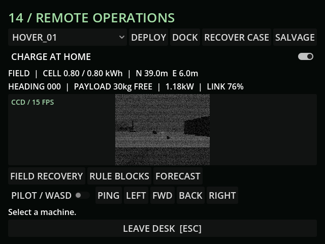

# M27d — Abrasive ash

Verified 10 October 2026 with live Godot MCP and GUT.

Full import and suite: 79 tests / 632 assertions pass.

- Weather tests: 6 tests / 52 assertions. Ash doubles measured armor wear and worn-part fault probability, resets on clear weather, and exposes the actual buried cache after 30 cumulative ash seconds.
- Live hover drove 4.433m through the collision world, transmitted salvage over the real radio link and attached the exposed cache's 30kg cargo.
- Cache pickup grants no inventory. Dock delivery grants 24 scrap once; subsequent ash cannot respawn it. Version 17 saves its buried/carried/delivered state and exposure time. A version 16 migration retains earlier delivery state and introduces the cache buried.
- PSX house box model and existing surface materials only; current game log is clean.
- The full-suite run exposed a retrace fixture that expected its unsaved forced radio multiplier to survive weather restore. Reapplied that test-only blackout after restore; production saved weather correctly controls its derived radio range.

