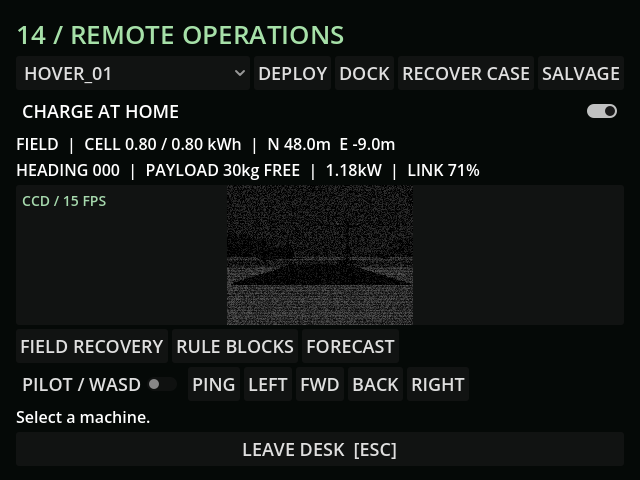

# M27e — Acid rain

Verified 10 October 2026 with live MCP and focused GUT suites.

- Weather: 8 tests / 78 assertions; power: 3 / 14; human recovery: 3 / 40, all pass.
- Rain adds 0.003 armor-condition loss/second outdoors and a 12% external cell-short risk per 60-second exposure cycle. Seeded live fixture produced 13 shorts in 100 rolls; faults stop cell-dependent motors/sensors for eight seconds. Ash now also has an independent 8% external bearing/lens fouling risk. These differ from intrinsic condition-band faults.
- Live hotspot fell from 100% to 96.95% after 61 simulated rain seconds. Exposure adds up to 0.5kW cell drain and filter use within 5m. Rain cleans at 0.05%/second until zero.
- Suit filter runs at 2x in rain, plus local radiation. Normal recovery regressions pass.
- v18 persists contamination, exposure cycles and RNG; v17 ash-only state migrates. Rendered PSX-metal streaks and hotspot use existing verified textures.
- Live rendering revealed material overrides become surface bindings after the root policy pass. Using the active material fixed the update; the subsequent runtime log is clean.
- Creature shelter behavior remains M29.

