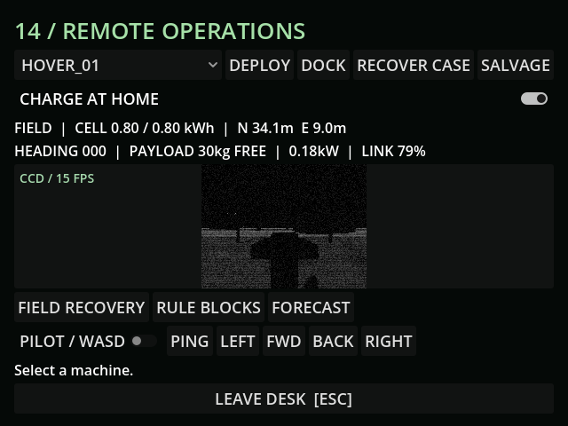

# M27f — Geothermal pockets

Verified 10 October 2026 with live MCP and GUT.

- Weather 9 tests / 88 assertions and power 3 / 14 pass.
- Live hover physically drove from E9/N30 into the pocket. Idle draw fell from 1.183333 to 0.183333kW: precisely the 1kW effective cold drain, with module draw retained.
- Inner ground slows movement to 55%. Sixty cumulative seconds within 2.5m causes five armor-condition damage and an eight-second joint jam. Saved partial exposure completes after reload; leaving restores normal terrain and cold draw.
- Existing warm vent, three PSX-metal warning stakes, 6m cold-free radius. No free battery charge or invented texture.
- v19 adds vent-cycle persistence. Current live runtime log is clean.

