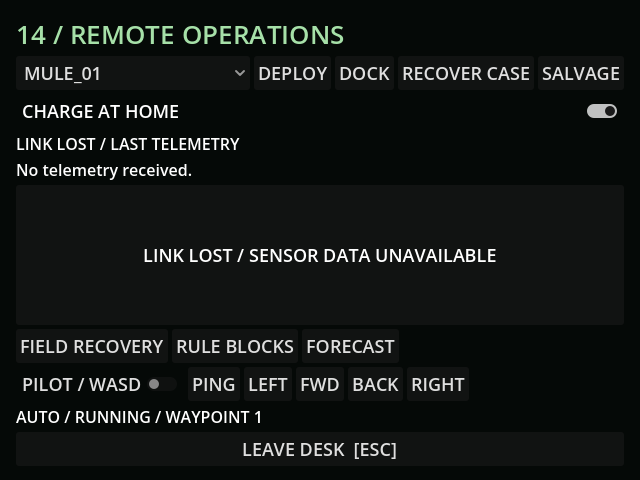

# M27g — EM aurora

Verified 10 October 2026 against live MCP and GUT.

Full import and GUT suite: 83 tests / 687 assertions pass.

- Live preloaded Mule drove 7.080m and loaded 24kg of local scrap with battery 0 and radio quality 0. Wireless ping rejected.
- Snapshot validation succeeds; restored aurora resumes eligible local programs. Clearing weather stops the empty machine immediately and retains battery 0.
- Ambient supply never enters stored battery, ignores low-cell abort only while eligible, retains cell/joint fault gates, and does not power unprogrammed/blocked/stopped hulls.
- Flare clears queued remote packets/actions. New programs and stop commands require a working radio; feeds/telemetry disappear during blackout.
- Normal freeze/retrace resumes after the event. Exterior purple sky uses environment settings; no new bitmap.
- Removed the hotspot marker's unintended warm signature after the full IR regression identified an extra heat return.

