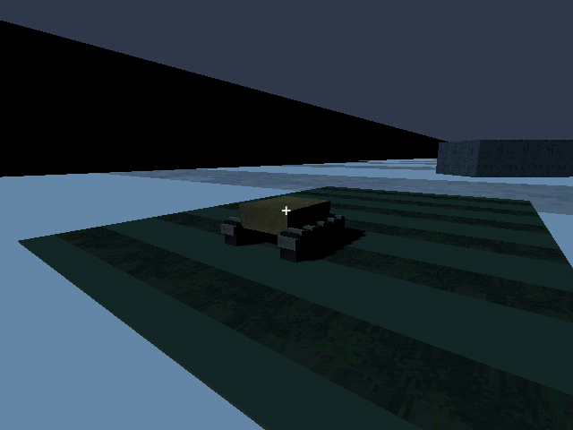
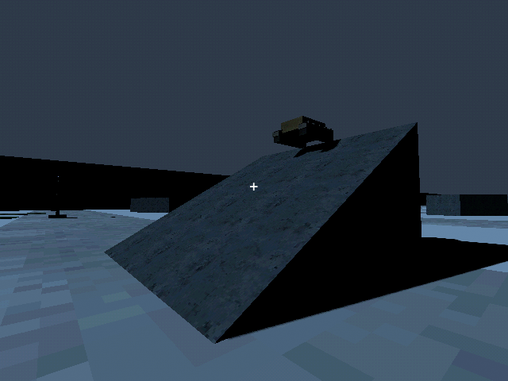

# M28a — Tracked platform

Verified 10 October 2026 with live MCP and GUT.

Full import and suite: 86 tests / 705 assertions pass.

- Convoy suite: 3 tests / 18 assertions. Actual tracked ramp ascent succeeds where a light hull stops; physical mud travel improves over 3x with scrapers; sealed housings reduce seeded rain shorts without eliminating them.
- Paid frame fabrication debits 70 scrap once, assembles from one stock frame, starts with an empty cell, and serializes validly. Light tool sockets reject the size-2 recovery winch.
- Live tracked hull ascended the physical 30-degree incline to Y3.917 at Z-76.461, on the floor, within its 42-degree limit.
- The first box ramp caught both hulls on its toe. Replaced it with a ground-level convex prism and added collision-checked foot adaptation. Autonomy/retrace use the same traversability check.
- Custom scraper/sealing shapes rendered using verified PSX surfaces. Live runtime log clean.

