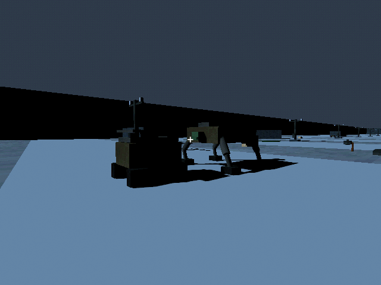
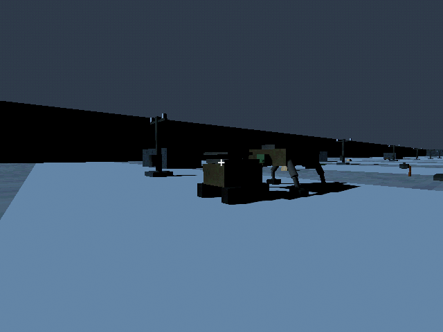
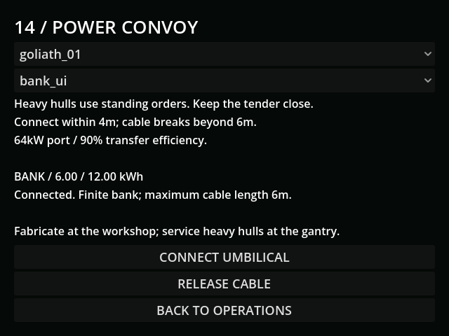

# M28b — Goliath and tender

Verified 10 October 2026 against MCP editor/runtime and GUT.

- Full import/suite: 88 tests / 735 assertions pass. Extended convoy, human and
  derelict checks cover UI correction, prefab payload and recovery guards.

Final focused convoy suite: 5 tests / 57 assertions; human 3 / 40 and
derelict 3 / 42 pass. Occupancy fixtures wait for physics synchronization.
- Live preloaded convoy drove the Goliath 1.905m using 0.0261767kWh from its bank.
  Heavy internal charge stayed zero. Cable gap stayed 3.317m.
- Operator drove the tender away over the real radio link. At 7.411m gap the
  cable was gone, heavy power false and velocity zero.
- Bank depletion and concrete obstruction interrupt actual supply. Invalid donor
  references are rejected; version 20 retains physical bindings and finite cells.
- Factory assembled an empty Goliath at the exterior gantry. Grid blackout holds
  unloading, paid supply completes it once, and the frame remains outside.
- Goliath cannot be manually piloted or woken by a pocket jumper. Coupler,
  portable solar and size-3 tools have physical socket, mass and draw limits.
- Live visual inspection caught the panel's unescaped percent formatter and
  transparent default background. Fixed formatting, opaque style and 640px fit;
  subsequent runtime is clean. Rendered models use verified PSX metal/radio only.

