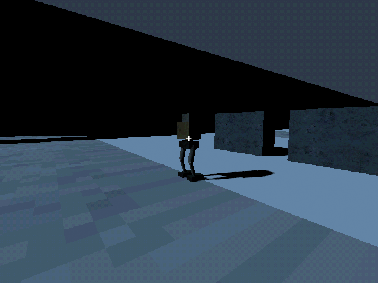
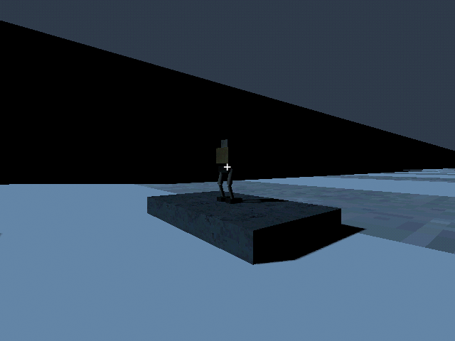

# M28c — Biped platform

Verified 10 October 2026 against live Godot MCP and GUT.

- Convoy suite 7 tests / 66 assertions; condition 2 / 21, surface 1 / 18,
  workshop 6 / 56 all pass.
- Actual biped passes the authored 1.1m opening and climbs the 55cm ledge;
  the wider Mule is blocked by both. Equal 10m travel costs 0.12 joint points
  versus 0.04 for a light hull, retained after save/load.
- Live radio piloting crossed the opening to Z-85.768, then climbed the ledge.
  Reviewed custom PSX-metal/radio form before the traversal test.
- Circuit, power, input and physical collision restrictions remain active;
  no human jump/flight feature. Runtime log is clean.

