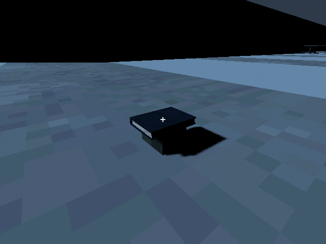
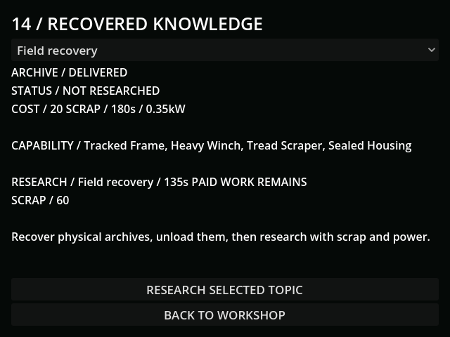

# M31 — Recovered knowledge and paid research

Verified 10 October 2026 with Godot 4.7.2, GUT 9.7.1 and the connected
Godot AI 4.3.0 editor. Final live run: `r18821501-56`.

- Reviewed the supplied PSX house-pack book on an authored metal crate before
  collecting it. Its effective albedo is 64px, nearest sampled, without mipmaps;
  imported embedded PBR materials are overridden. No invented texture paths.
- Six physical archives occupy authored sites. An actual transmitted archive
  action attached the recovery manual to the Mule: 1kg cargo, research rejected
  while carried. The ordinary loader ran for eight real seconds and removed
  that cargo exactly once. The live midway check still had 2.98 seconds remaining.
- Research spent 20 scrap, leaving 60. After 45 freshly paid grid seconds,
  save/Continue retained 135 seconds, the delivered archive and the same stock.
  Completion unlocked tracked recovery recipes, kept heavy engineering locked,
  cleared its 0.35kW load and rejected repeated purchase.
- GUT covers insufficient/prerequisite/duplicate purchases, loader conservation,
  blackout, half-paid time, carried and paid saves, invalid carrier mass,
  pre-research migration and pause/resume. Existing recipes are grandfathered
  for old saves without silently earning new technologies.
- Full verification: **108 tests / 939 assertions passed**, import passed.
  Focused research suite: **5 tests / 73 assertions passed**. One initial fixture
  assertion measured charger recalculation together with research; corrected to
  measure the added research demand before the grid tick, then reran the suite.
- Fresh rendered panel, workshop back navigation and operations-services menu
  all passed. Final button ends at y=464 within the 480px display. Capability
  labels use readable words. Current-run game log has no gameplay errors.
- Live saves use `user://tests/m31_live.json`. Default slot was not written;
  SHA256 remains `0E87B81303490B7AF6775924B636A8EFEAB2704A82B0948778A360D170A540DA`.

Tunable engineering choices: [progression](../design/PROGRESSION.md).
Human pacing assessment remains open; these checks establish behavior.
