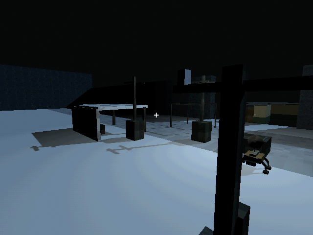
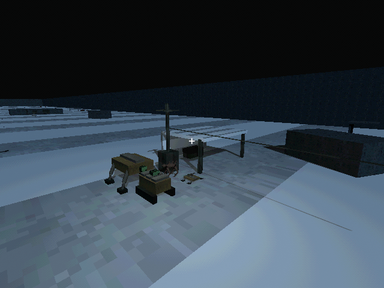
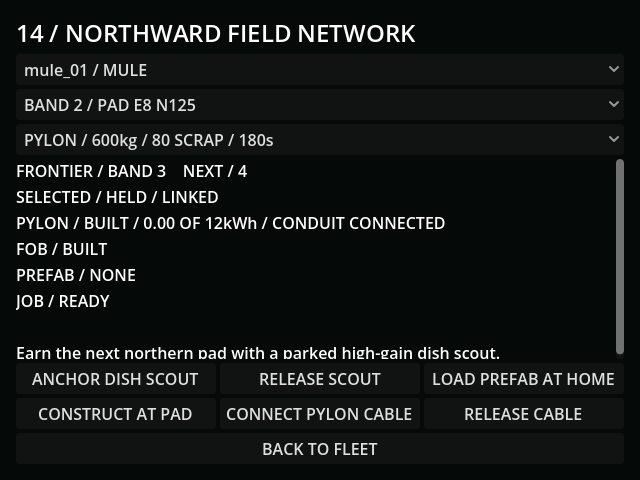

# M32 — Northward relay, charging and forward depots

Verified 10 October 2026, Godot 4.7.2/Jolt, connected Godot AI 4.3.0.
Final run `r19624423-59` was live with no current-run gameplay errors.

- Rendered native dish, packed structure, pylon and sheltered depot with the
  existing verified PSX metal/concrete/stone textures. Review screenshots use
  an explicitly staged light for inspection, not an added campaign light.
- Actual scouts claimed adjacent pads at N125 and N225. Quality at N225 was
  0.316365; emptying the upstream scout's cell cut it to zero, restoring the cell
  restored that quality. Skipping a band was rejected. Tests also cover sideways
  placement, repeat claims, moving/replacing scouts, packet loss and aurora.
- A powered Goliath loaded a paid 600kg pylon at home, spent 80 scrap and started
  construction at the earned pad. Four real seconds reduced its job to 176s,
  consumed 0.030475kWh from its tender and reserved its controller. Its work
  produced actual acoustic emissions. No small hull can carry the prefab.
- Isolated save/Continue preserved the paid job at 142.383333 seconds and 600kg.
  Finishing that remaining controlled simulation interval consumed convoy energy,
  delivered one structure, removed its cargo and created **zero** battery energy.
  One freshly paid grid second subsequently added exactly 1/3600kWh.
- The 1400kg FOB consumed 150 scrap and 300 powered seconds, required its pylon
  and a clear footprint, and produced a physical roof/storage shelter once.
  A subsequent Continue preserved its completed state and both earned bands.
- During the extended live scenario, the original mutant destroyed the parked
  relay Mule. With that scout dead and the pylon empty, the downstream site went
  offline. Grid charging restored the pylon relay (quality 0.298210); a fixed
  relay's packet blackout cut it to zero and recovery restored it. Relay pulses
  raised actual sector trace (observed delta 0.48 including other active radios).
- Finite 12kWh pylon banks supply nearby cells or physically cabled heavy hulls.
  Tests verify blackout, upstream/solid conduit loss, fresh grid payment, finite
  transfer, depletion stopping the actual heavy motor, cable reach and rejecting
  simultaneous tender/pylon donors. Loaded winches cannot be removed from cargo.
- Full regression: **114 tests / 1,029 assertions passed**, import passed.
  Final focused affected suites: territory 6/98, radio 2/13, trace 6/55,
  mutants 6/51: **20 tests / 217 assertions passed**.
- Final rendered controls fit: minimum width 536px, final button ends at y=464.
  Field network is available from the operations-services menu.
- Every live save used `user://tests/m32_*.json`; the default-slot SHA256 remains
  `0E87B81303490B7AF6775924B636A8EFEAB2704A82B0948778A360D170A540DA`.

[Tunable engineering choices](../design/TERRITORY.md). Fixed pads instantiate
the existing six bands; authoring rewards/objectives remains M42. Freight,
underground connectivity, defenses and final pacing remain their own checkpoints.
