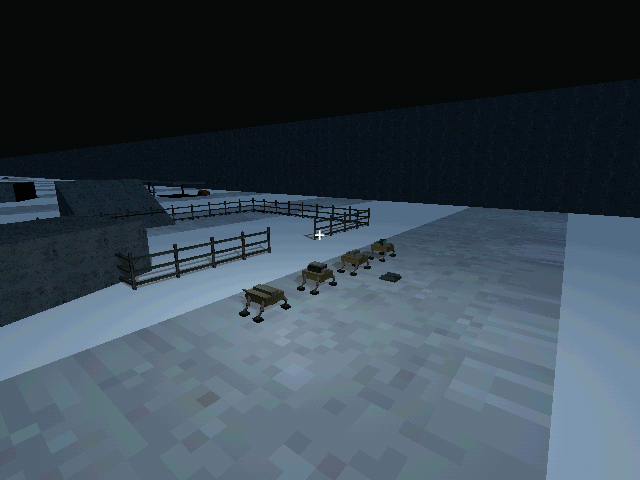
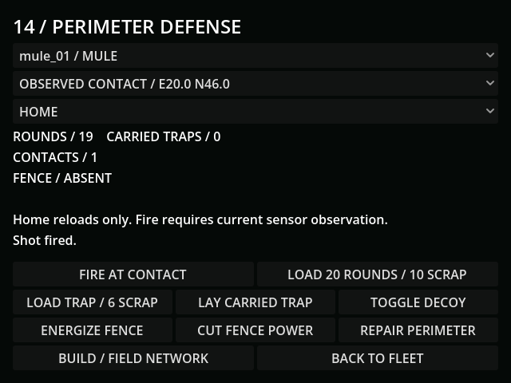
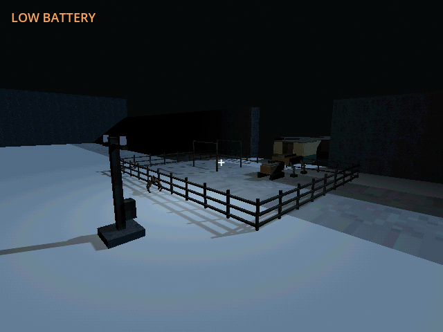
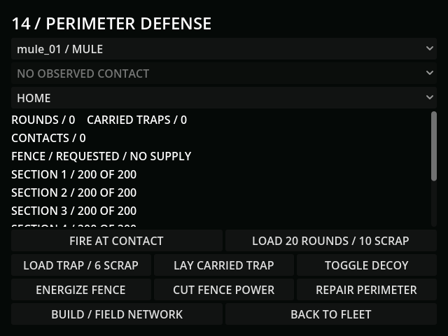
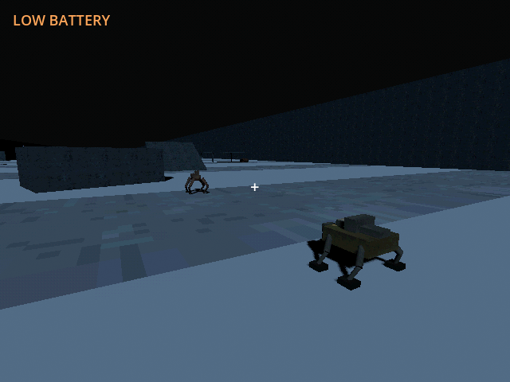

# M33a — Defensive hardware and powered perimeters

Verified 10 October 2026, Godot 4.7.2/Jolt and Godot AI 4.3.0. Fresh final
live run r20823623-61 had no current-run gameplay errors.

- Native gun, trap magazine, floodlight, speaker, spring trap and five-section
  perimeter were rendered for inspection using verified PSX house-pack surfaces.
  Review lighting is staged only; production floodlights are actual spot lights.
- A live terminal button queued an observed anonymous contact. Its delayed shot
  spent one round and 0.02kg, leaving 19 rounds / 0.38kg, and dealt 48 damage
  with fresh +20% part efficiency. Reloading an in-flight 0.15315s fire order
  delivered precisely one further shot: 18 rounds / 0.36kg / target integrity 4.
  No enemy health or unseen identities are displayed by the terminal.
- Actual paid Goliath construction loaded 800kg for 60 scrap. Two real seconds
  left 238.01667 seconds of work; completing the controlled remaining interval
  consumed tender energy, created one collidable home perimeter and removed
  that cargo. Stock was 20 and the tender retained 10.2584kWh.
- Enabling fences added 2kW to real grid demand. One paid contact second changed
  mutant integrity 100 to 60; a blackout second left it at 60. A local physical
  strike damaged a section 200 to 155, and repair spent 5 scrap to restore it.
  Isolated save/Continue preserved the restored fence, its power request and 15
  scrap. Final blackout UI correctly says REQUESTED / NO SUPPLY.
- Live floodlight response moved the existing mutant 4.4367m away in two seconds
  (gap 6 to 10.4367m), in avoid_light mode. Silent running turns the actual lamp
  and sensory source off; the rendered cone and sensing direction agree.
- GUT covers finite rounds/energy, real latency, cooldowns, saved pending orders,
  sensor absence, current visibility, cover and lost-link cancellation; paid trap
  cargo, wall-blocked/once-only triggering after reload; partial/zero fence supply,
  actual collision/destruction, finite field banks, paid prefab build/repair,
  light direction, decoy trace, UI fit and malformed/migrated saves.
- Full regression before final refinements: **121 tests / 1,129 assertions passed**,
  import passed. Final affected suites after ray/beam/supply-UI refinements:
  defense 7/95, territory 6/98, mutants 6/51: **19 tests / 244 assertions passed**.
  Thin-collider ray endpoints were corrected to aim inside the collider after a
  field-contact regression caught Jolt omitting exact surface endpoints.
- Terminal minimum width 493px / height 315px; all actions fit, last button ends
  at y=464. Long owned-fence readings scroll. Empty contact selection is explicit.
- Every live save used user://tests/m33a_*.json; default-slot SHA256 remains
  0E87B81303490B7AF6775924B636A8EFEAB2704A82B0948778A360D170A540DA.

[Engineering choices](../design/DEFENSE.md). Coordinated pack behavior is M33b;
this checkpoint verifies attack/damage components, not coordinated autonomous
sieges or underground ingress. Human combat/pacing assessment remains open.
