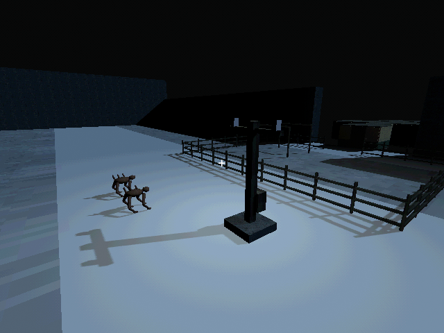
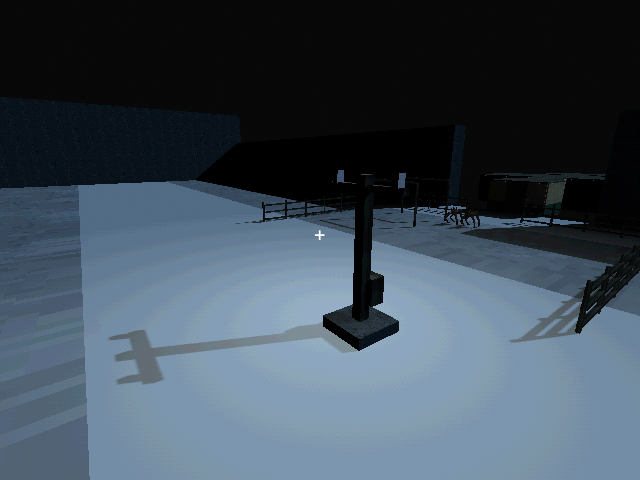
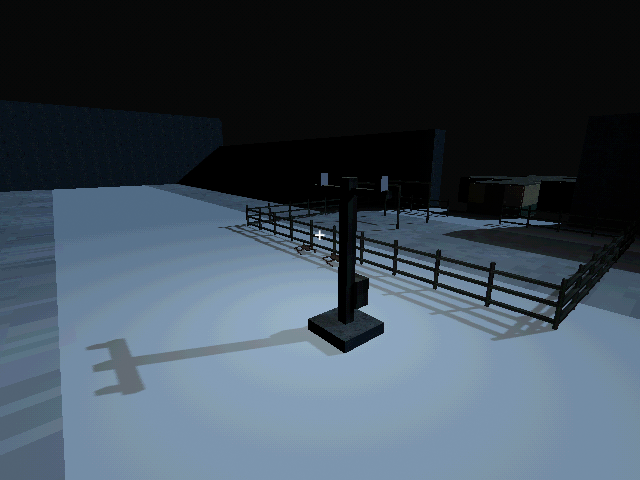

# M33b — Coordinated siege response

Verified 15 October 2026, Godot 4.7.2/Jolt, Godot AI 4.3.0.
The editor was closed on resumption; reopening this project restored the bridge.
Connected session game-project@df6c6d8ab7800210, live run r135508-1. Current-run
game logs were free of gameplay errors and screenshots were fresh.

- A home-known active nest coordinates only its existing surviving recruits.
  Unknown-home and insufficient-population gates create no extra enemies.
  Separate rally slots, a minimum 12-second gathering interval and actual body
  arrival precede an assault. Physics/collision movement continues throughout.
- Live controlled pack: two existing-model patrols moved from N43 to N38.65
  within two seconds, in forming phase; total actor count remained three
  including the original distant scout. They physically approached the barrier.
- Unpowered comparison: the north section reached 0 integrity, lost collision,
  and both attackers crossed it to N18.62/N18.64 by the exterior airlock.
  No remote bunker damage or forced entrance was substituted for movement.
- Powered comparison: both attackers died outside the north fence, at N30.77
  and N30.79, while that section survived at 20/200. The siege ended and entered
  its per-nest cooldown. The finite grid battery fell from 2 to 1.983kWh at the
  final check, including continued fence demand after the fight.
- An actual barrier grip now conducts on the next paid fence tick during its
  strike cooldown. Ordinary contact remains limited to 0.65m; forelimb strike
  contact uses 1.8m with physical cover checked. This fixes striking from just
  outside body-contact distance without granting unpowered damage.
- Save/Continue retained the active roster and saved attack clock. Rain changed
  the assault to retreat with a real homeward goal. A separate defended save
  retained the 20-integrity section, idle phase and exact 248.083333s cooldown;
  schema validation returned an empty error and the operator remained indoors.
- Tests cover knowledge/population gates, no spawned reinforcements, separate
  real formation movement, arrival gating, collision attacks/destruction and
  crossing, defended versus neglected outcomes, finite power, rain, nest
  clearing, pack loss, cooldown persistence, old-home migration and invalid
  roster rejection.
- Full regression: **126 tests / 1,169 assertions passed**, import passed.
  Final siege suite after the added pack-loss/cooldown case: **6 tests /
  44 assertions passed**. Earlier defended-scenario failure exposed the
  forelimb-contact gap and was corrected before these passing checks.
- All live writes used user://tests/m33b_* slots. The existing default save
  (last written 11 October, before this work) stayed byte-identical to the
  preserved pre-verification copy: SHA256
  5FF9FCFA19414DF1A8E20847B69DA45BCF96C48330B4E1CD9AF59DE603211D75.

[Engineering choices](../design/DEFENSE.md). Entry forcing and underground
breaches remain M40; human assessment of combat readability/pacing remains open.
