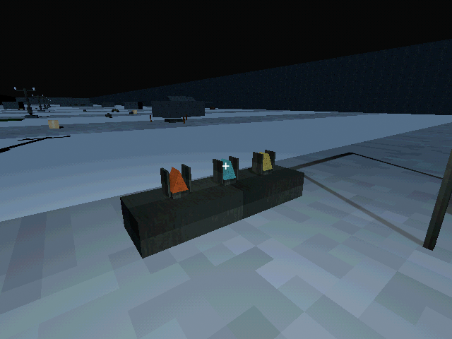
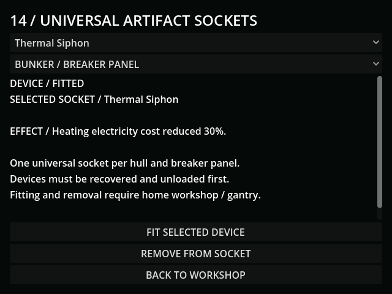
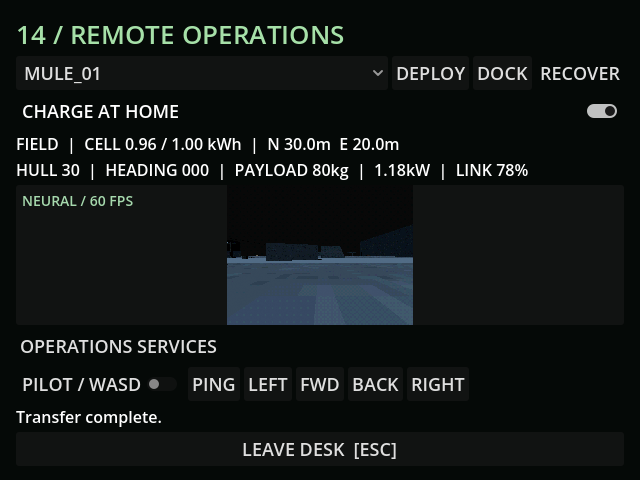
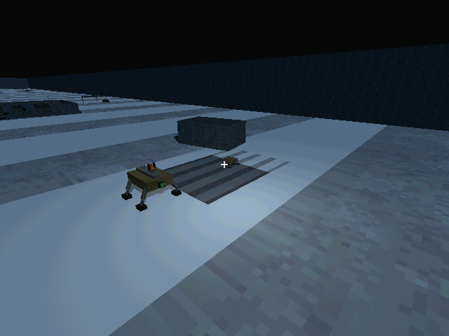
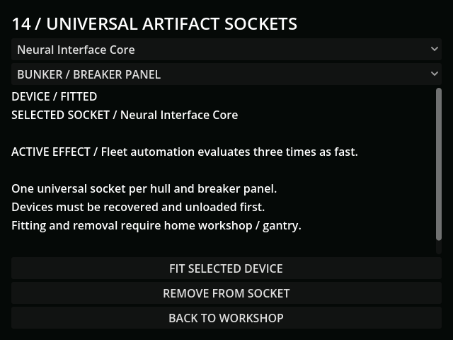

# M34 — Universal artifact sockets and nine effects

Verified 15 October 2026, Godot 4.7.2/Jolt and Godot AI 4.3.0.
Final live run r1874243-4 had no current-run gameplay errors and fresh captures.

- Three native caged anomaly meshes were reviewed using the already verified
  PSX metal/stone textures. Unique devices use one universal slot per hull or
  breaker; fitted mass counts against payload. No human implants were added.
- A live transmitted recovery command attached the actual Thermal Siphon at its
  authored site as 1kg cargo. A controlled relay fixture supplied this scenario's
  link; it is not evidence of an additional paid network build. The ordinary
  loader still had three seconds left at the five-second check, then unloaded
  once. The real socket button fitted the delivered device in the breaker.
- Thermal small: continuous sound reach became zero and cold demand fell by
  1kW in the live fixture. Removal restored both; deliberate sonar/fire reports
  remain audible. Thermal heavy: an intact stranded Goliath radiated its real
  10m ring, removed nearby cold drain and changed frozen-ground travel factor
  from 0.6 to 1 inside it; the outside remained 0.6. Boundary 10m succeeded and
  10.01m failed. Solid heat occlusion is covered by GUT. Thermal breaker reduced
  demand 5.9 to 5.36kW: exactly 30% off the existing 1.8kW heater.
- Neural small: actual 640x480 clean viewport, 60 new frames in one second,
  with the feed shader in clean mode. Neural heavy: real manual input moved a
  powered Goliath 1.0475m in 1.5 seconds, consuming tender energy, while its
  ordinary fitted CCD remained the 15 FPS source. Neural breaker: final live
  physics measured **12 versus 36** rule evaluations per second, with 60 physics
  frames. Motor speed is unchanged. The normal CCD separately measured 15
  frames in one live second.
- Photonic heavy: actual required external draw fell 17.7 to 14.16kW (ratio 0.8);
  the umbilical remained necessary. Photonic small: a controlled 36-second
  energy step ended at 0.9067480324kWh, exactly the calculated finite trickle
  minus ordinary draw. Photonic breaker: separate 0.25kW generation produced
  0.9989861111kWh after the controlled grid step; solar refresh retained it.
  Removing the device cleared its contribution.
- Neural/photonic delivered-stock setup was controlled for effect testing;
  the physical recovery/unload path was independently exercised with thermal.
  All three move through small/heavy/breaker contexts in automated tests.
- Save/Continue restored the fitted Neural breaker at rate 3, heater factor 1
  and photonic contribution 0, without stacking old effects. Repeated restore
  and removal of every breaker variant are covered by GUT, alongside uniqueness,
  carrier/payload validation, migration, visual/radio gates and panel navigation.
- Full regression after the aurora integration fix: **133 tests / 1,285
  assertions passed**, import passed. Final affected suites after timing fixes:
  artifacts 7/112, orders 5/30, optical progression 2/18, weather 10/107:
  **24 tests / 267 assertions passed**.
- Live cadence checking caught near-boundary floating-point double evaluations
  missed by direct delta tests. Clock subtraction now clamps the tiny residual
  instead of preserving it through fmod; real-physics-frame regressions cover
  12Hz/36Hz rules and 15Hz CCD. A separate earlier regression had dropped held
  autonomous commands during aurora; the existing weather scenario caught it
  and now passes with local field-powered orders.
- Recovery actions share a menu so the fleet toolbar fits 640px. Artifact
  controls fit the display: minimum 436x245, final button ends at y=464.
  Active effects and prospective effects are labeled separately.
- Only user://tests/m34_* slots were written. Default-slot SHA256 remains
  5FF9FCFA19414DF1A8E20847B69DA45BCF96C48330B4E1CD9AF59DE603211D75.

[Engineering choices](../design/ARTIFACTS.md). Human pacing and strategy evaluation
remain open; accelerated scenarios do not establish campaign duration.
