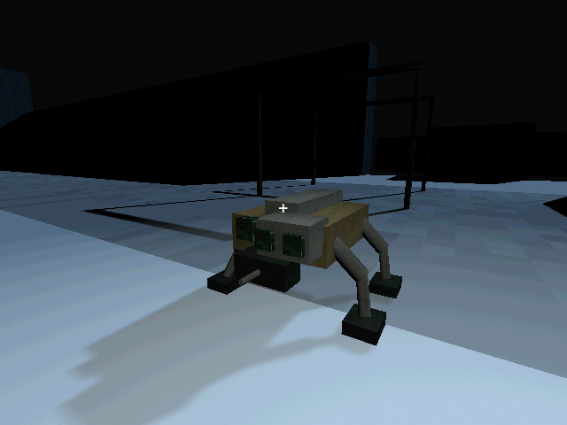
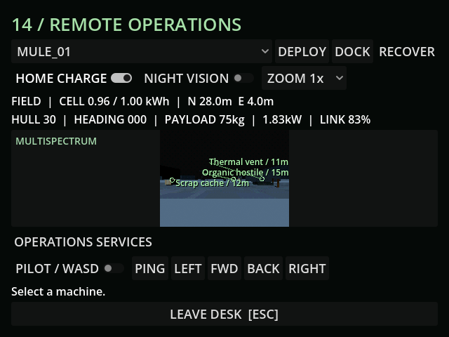
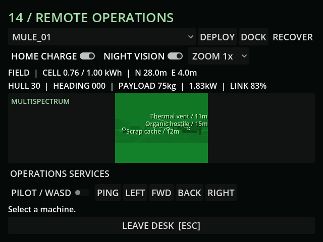
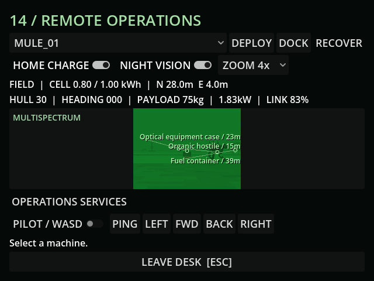

# M35 — Earned multispectrum optics

Verified 17 October 2026, Godot 4.7.2/Jolt and Godot AI 4.3.0.
Final connected editor game-project@176e41644c891817, run r305325-3, fresh
screenshots and no current-run gameplay errors. A mid-check bridge disconnect
was resolved by restarting only this task's editor/game processes before work
and live verification resumed.

- Reviewed the additional native optical head using existing verified PSX metal
  surfaces. No new bitmap or invented texture path. Ordinary CCD and the Neural
  artifact stay separate sources without free classification or night vision.
- Controlled prerequisite-research setup unlocked the actual paid recipe.
  Fabrication spent 80 scrap and 180 fresh grid steps (three fuel minutes), then
  the workshop removed the old sonar and fitted the manufactured 10kg, 0.8kW
  module. Live hull payload was 75kg free, total field draw about 1.83kW.
- Live source viewport was 640x480, with 59 fresh frames in the sampled
  one-second timer interval. Real physics tests accept 59–61 frames across 60
  physics ticks; worn 10% optics give about 21Hz. Faults and empty cells stop
  new frames. Repair consumes scrap and restores the actual lens.
- Automatic tags identify visible salvage, optical equipment, tracked chassis,
  pylons, archives and organic contacts, with camera range and projected bounds.
  The render fixture placed and froze the existing mutant for camera comparison;
  this is not a combat/pacing scenario. Tags never disclose its health or ID.
- Actual terminal toggles produced the green low-light view and 4x digital crop.
  Zoom narrowed the local result from ten contacts to four. A physical wall then
  hid the organic contact, optical case and fuel container, leaving only a pylon
  along an unobstructed ray. Removing the wall restored all four contacts.
- A live sensor fault yielded zero new frames in 0.5s, no tags, and OPTICS FAULT /
  NO NEW FRAMES. A packet blackout hid the feed after the UI refreshed, yielded
  zero tags and LINK LOST / SENSOR DATA UNAVAILABLE; recovery restored the feed
  and its remembered modes.
- Isolated Save/Continue retained night vision and 4x zoom. Schema v28 validates
  per-hull modes; old snapshots receive defaults. Duplicate/out-of-range or
  missing settings are rejected where required. Bare drone-model snapshots also
  work without scene children, after the full regression caught that case.
- Full import and regression passed **139 tests / 1,350 assertions**. Focused
  advanced optics: **5 tests / 61 assertions**; final model serialization check
  **4 tests / 31 assertions**. Tests cover paid hardware, power demand, frustum,
  zoom, distance, hidden objects, solids, faults, wear/repair, radio loss, saves,
  migration, actual UI controls and Neural/source separation.
- The compact overlay labels up to three useful contacts, prioritizing hostiles,
  with clipped-length, separated labels. A tone-compressed night image preserves
  detail; zero received light stays black. Final panel minimum 545x478, final
  button bottom y=464 within the 480px display.
- All live writes used user://tests/m35_* slots. The default save remained
  byte-identical to its pre-verification copy: SHA256
  5FF9FCFA19414DF1A8E20847B69DA45BCF96C48330B4E1CD9AF59DE603211D75.

[Engineering choices](../design/ADVANCED_OPTICS.md). Human readability and
campaign upkeep balancing remain open.
