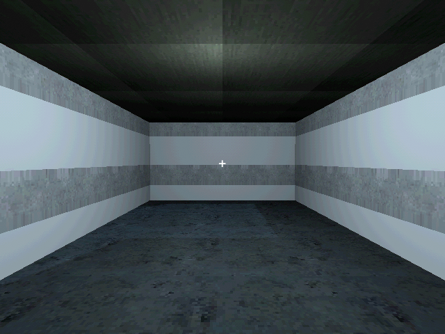
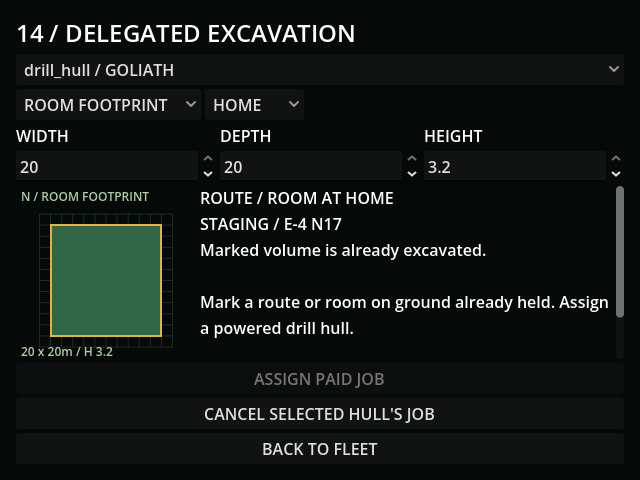
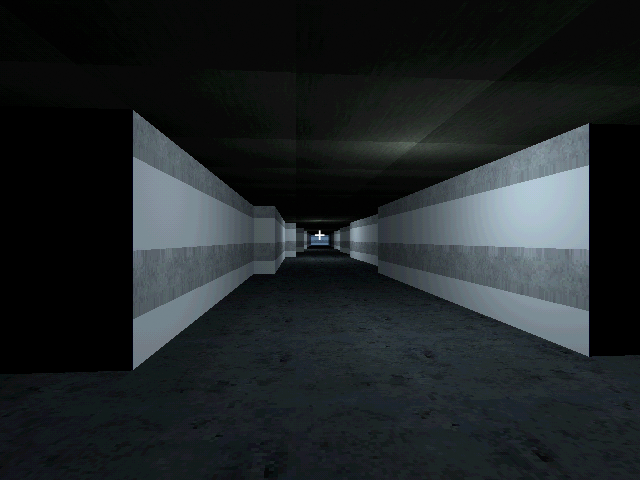

# M36 — Delegated tunnel and room excavation

Verified 18 October 2026, Godot 4.7.2/Jolt, Godot AI 4.3.0.
Connected editor game-project@c43d8df02d15267a; final fresh run r1112891-6
had no current-run gameplay errors. Staged underground lights are diagnostic,
not a claim that rail/wiring installation is already implemented.

- Reviewed the native PSX-lined underground geometry before acceptance. Initial
  review exposed reversed triangle facing: vertices existed but the floor was
  invisible and rays passed through. Corrected winding produced real hits at
  floor Y=-6, roof Y=-2.8 and west/east room boundaries.
- The terminal marks adjacent held-hub routes or rectangular room footprints,
  within the 3.2m single-pass height cap. Unheld destinations, skipped/reversed
  hubs, unreachable starts, bad dimensions and missing tools charge nothing.
- A live terminal button assigned a 6x10x3.2m room to the actual drill-fitted
  Goliath: five scrap, 76.8 nominal seconds. Three real seconds left 73.22
  seconds, consumed about 0.025kWh from the tender and reserved its controller.
- A room expansion saved/reloaded at exactly 435.2 seconds with 967 scrap.
  Its remaining 362.6667 supplied seconds consumed 2.910288kWh and completed
  the 20x20m room. Source dimensions and payment remained intact.
- A new tunnel was rejected before its destination was held. A controlled
  already-held pylon fixture then supplied that acceptance precondition; this
  is not evidence of an extra paid surface build. The tunnel charged 51 scrap
  and 803.84 nominal seconds. Its 669.8667 supplied seconds consumed
  5.375473kWh, leaving one finished route, 1,028 union cells and no active jobs.
- Actual room/tunnel collision was checked with a ray through the complete
  joined passage. A temporary 1.7m capsule fell onto the generated floor,
  settled at Y=-5.99914 and reported is_on_floor=true. It did not fall through.
  Completed Save/Continue retained the room, route, 1,028 cells and 916 scrap.
- Payment is a fresh, single-use tender/pylon work-time credit, including
  fractional supply at exhaustion. Restart discards these derived credits.
  Local aurora intent follows the existing temporary field-power rule without
  adding battery charge. Normal loss holds work and allows the fitted failsafe.
- GUT covers paid/replayed/partial power, source loss, staging/tool/link holds,
  cancellation without refunds, destroyed-worker abandonment, reload, once-only
  completion, actual floor/roof/wall/join geometry, pause, aurora, invalid saves,
  migration, separate workers and overlapping-footprint rejection.
- Full import and regression: **147 tests / 1,455 assertions passed**.
  Final focused excavation suite after worker-loss and immediate UI-limit
  refinements: **9 tests / 119 assertions passed**.
- UI uses an enlarged room footprint with existing volume in green. Paid jobs
  show remaining work, preserve their selected dimensions on worker selection,
  and block duplicate assignment. Room/tunnel limits change immediately with
  mode. An existing footprint cannot be shrunk or bought again. Minimum panel
  372x307; last button ends at y=464 within 640x480.
- Existing editor-normalized resources/addons outside this checkpoint were
  preserved and not staged. All live writes used user://tests/m36_* slots.
  Default-slot SHA256 remains
  5FF9FCFA19414DF1A8E20847B69DA45BCF96C48330B4E1CD9AF59DE603211D75.

[Engineering choices](../design/EXCAVATION.md). Rails, freight and passenger
access follow their checkpoints; human pacing/readability remains unmeasured.
