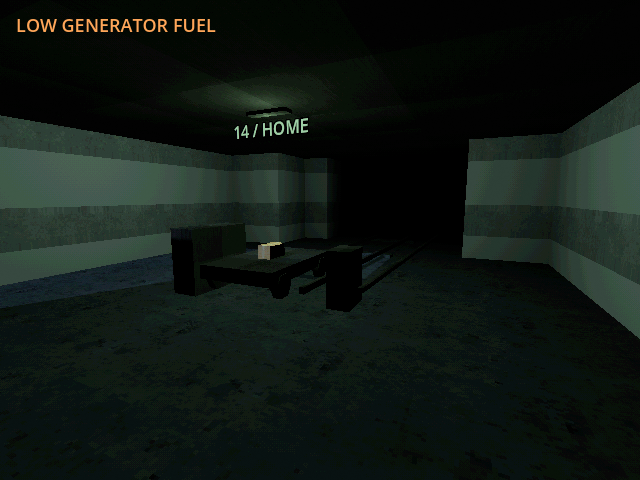
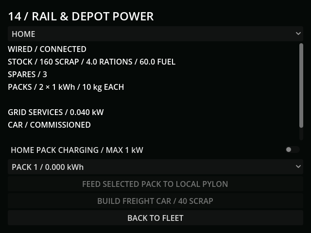
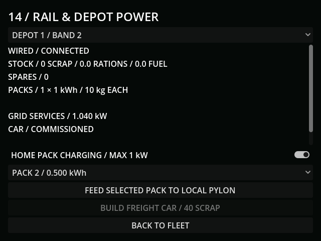

# M37a — Rail stations and finite depot power

Verified 20 October 2026, Godot 4.7.2/Jolt, Godot AI 4.3.0. Connected editor
`game-project@b04dcbbc673f46c8`; fresh final run `r432490-2` (the bridge reports
the authoritative run ID in its log). Native tracks, conduit, stations and the
parked car were reviewed in the running game before acceptance. All mesh surface
art uses verified PSX modular house files; the supplied `props/box.glb` is reused.

- Completed tunnels commission rails and separate depot stores immediately,
  including when saving during the completion step. Already-paid lining is not
  charged again. Station elevation follows the actual excavated floor/height.
  Wireless dropout and smog/ash/rain/aurora do not cut healthy wired paths.
- One car costs 40 scrap and 120 freshly funded assembly seconds at 0.6kW.
  A live terminal button charged 200 → 160 scrap once; 3.2 wall-clock seconds
  yielded three actual energy steps and 117 seconds remaining. Reload retained
  117 seconds and 160 scrap. A subsequent two-second blackout with a stale saved
  `supplied_fraction=1` performed no work. Paying the remaining 117 steps
  commissioned exactly one car.
- Portable packs cost 8 scrap/45 freshly paid fabrication steps, start empty,
  retain unique serial identity and have 1kWh capacity / 10kg fixed mass. A live
  fabrication completed pack 1 at zero charge, leaving 152 scrap. Ten paid
  charging steps added exactly 10/3600kWh. Charging is optional and capped at
  1kW across packs, including the last partial fill. Blackout adds no energy;
  a separate live half-funded step added 0.5/3600kWh.
- Separate controlled field-stock setup (not freight delivery evidence): pack 2
  with 1kWh at depot 1 fed a local pylon from 11.55 to 12kWh, retaining the same
  pack at 0.5kWh. The remaining energy is reusable. No stock teleports to the
  home pool. Automated freight and field workshop services belong to M37b.
- Save v30 retains car payment, stocks, charge and identities. Duplicate parts,
  duplicate packs, unallocated serials, fractional serials, NaN and out-of-range
  charge fail validation. v29 tunnels migrate to empty depots without a free
  car or pack. JSON charge round trips are checked with floating tolerance.
- Terminal render fits 640×480; minimum 353×258, final back button ends at Y464.
  Paid lighting is 0.02kW per connected hub and begins dark after reload until
  a new grid step pays it. The temporary review camera is diagnostic only;
  player passenger access remains M38.
- Full regression: **155 tests / 1,561 assertions** passed. After the immediate
  commissioning and wheel-height adjustments: rail **8 / 103**, excavation
  **9 / 119**, workshop **6 / 56**, all passed. Import and diff checks passed.
  The initial live run recorded a Windows WASAPI output-device invalidation;
  no gameplay script error was reported. Final fresh-run MCP logs contained
  only the helper registration and no errors or warnings.
- All live saves used `user://tests/m37a_live_20261020.json`. Default save SHA256
  remained `5FF9FCFA19414DF1A8E20847B69DA45BCF96C48330B4E1CD9AF59DE603211D75`.

