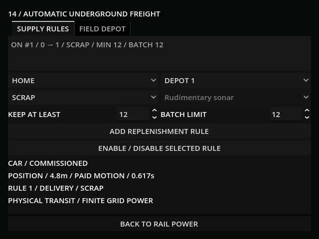
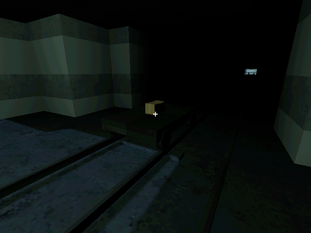
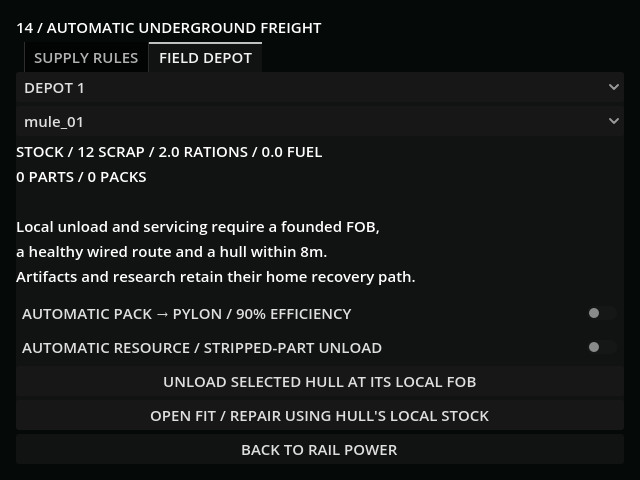
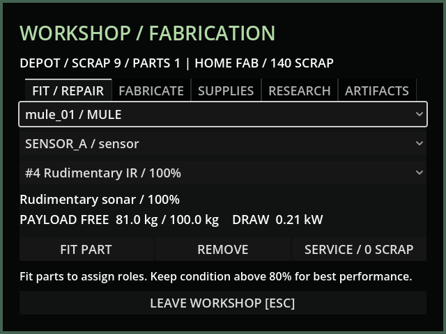

# M37b — Automatic freight and field services

Verified 20 October 2026 using Godot 4.7.2/Jolt and Godot AI 4.3.0. Editor
`game-project@b04dcbbc673f46c8` served live evals and fresh 640×480 screenshots.
Run `r1032507-4` supplied the illustrated live scenarios. All fixtures/saves are
isolated in `user://tests/m37b_live_20261020.json`; their already-held route and
FOB are controlled acceptance preconditions, not evidence of extra paid builds.

- The live Add Rule button created home → depot 1 / scrap / minimum 12 / batch
  12. After 3.2 real seconds the physical car had travelled 4.8m; home stock
  changed 152 → 140, destination stayed zero, and 12 units were aboard. Motor
  credit was finite. Saving/reloading preserved position and remaining credit
  within 1e-6. A paid grid step after reload lit the station; no free restored
  lighting was used for the reviewed transit screenshot.
- The rest of that 112.285m route completed in 54 stepped, paid seconds and
  credited 12 scrap once. A subsequent automatic round trip delivered two
  rations: home 4 → 2, depot 0 → 2. A thermal spare retained serial 2 and 85%
  condition in transport. A controlled Mule at its founded FOB fitted it and
  repaired it to 100%, consuming three local scrap; home stock stayed 140.
  The standing scrap rule later supplied the missing three automatically,
  ending at depot 12 / home 137. It shared the car with other pending rules.
- Controlled pack starting stock: existing serial 1 was set to 1kWh for this
  transport scenario (paid manufacture/charging are separately verified in
  M37a). Freight delivered that same full pack. A full pylon correctly refused
  to drain it; after setting the controlled bank to 11kWh, automatic feed added
  0.9kWh and retained the same empty pack. The return rule delivered serial 1
  home at zero charge, leaving no copy in the field store or car.
- GUT covers all named goods and optional fuel, physical source approach,
  depleted source recovery, rotating rules, actual paid motor draw, power loss
  after reserve exhaustion, wireless/aurora independence, full bulk/pack
  destination holds, disabled loaded rules, cancelled empty approaches,
  identity-preserving mid-trip reload, malformed saves and v30 migration.
  Empty-return/recharge conserves energy. A full output store holds fabrication
  without manufacturing a 129th pack. Automatic resource/stripped-part unloading
  and local fit/remove/repair retain archive cargo and enforce FOB/range gates.
- Freight terminal minimum 459×366; back button ends at Y464. Both tabs and the
  local-stock workshop screen were reviewed in the live framebuffer. Surface
  textures and the native car remain the verified M37a PSX geometry/materials.
- Full suite **168 tests / 1,696 assertions** passed. Final affected freight
  suite after empty-approach cancellation and service overlay checks:
  **13 / 136**, all passed. Import and
  diff checks passed. One earlier diagnostic eval called an incorrectly named
  visual-refresh helper and debugger-broke that run; it was restarted and the
  actual method used. Fresh run `r1365035-5` loaded all five saved rules and the
  returned empty pack, with clean current-run logs. Final fresh run
  `r1429461-6` verified the full fleet → rail → freight → workshop path: all
  covering panels hide and the local-stock workshop is visible; logs are clean.
- Default save SHA256 remained
  `5FF9FCFA19414DF1A8E20847B69DA45BCF96C48330B4E1CD9AF59DE603211D75`.
  These accelerated checks do not establish human campaign pacing or fun.

