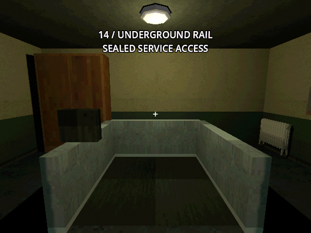
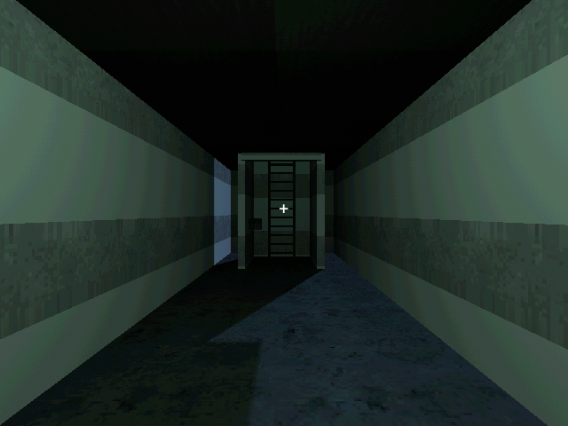
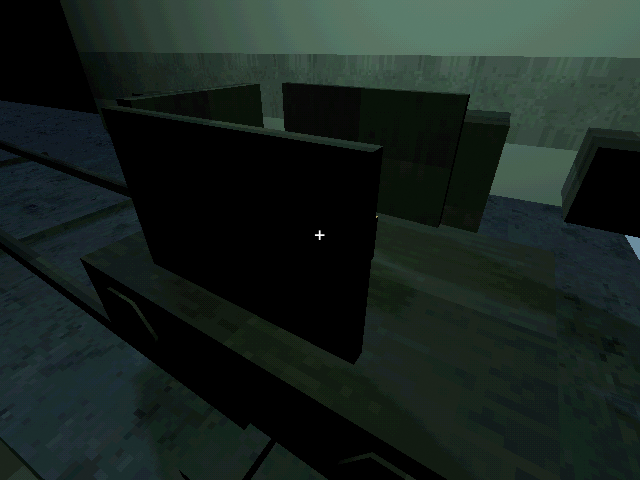
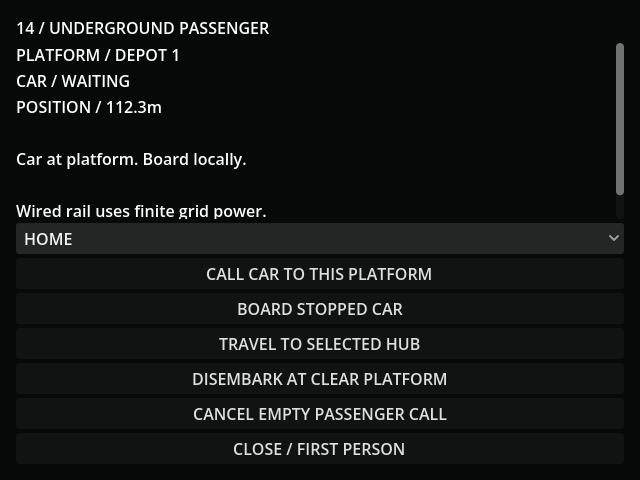
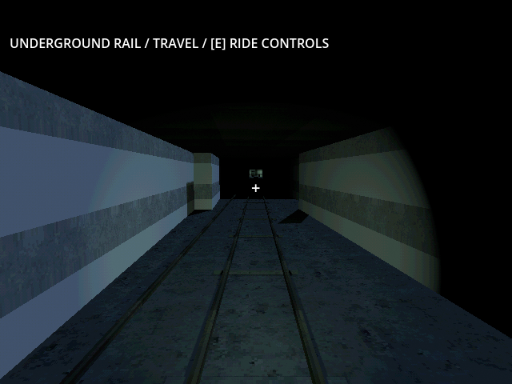

# M38 — Underground passenger travel

Verified 20–21 October 2026 with Godot 4.7.2/Jolt and Godot AI 4.3.0. Latest
connected editor: `game-project@d5d2388e49bf2eb1`. Illustrated final round trip
used live run `r232398-2`, the actual operator camera, interaction rays and
walking collision. Earlier 20 October runs exercised retrofit payment, the
first descent, climb/rider reload and the paid lamp. All saves used
`user://tests/m38_live_20261020.json`; the inherited
held tunnel/FOB are controlled acceptance preconditions, not new construction.

- The live retrofit button charged 137 → 112 scrap once. After 3.2 real
  seconds, 87 of 90 powered assembly seconds remained. Save/reload retained 87
  seconds and 112 scrap; paying the remainder commissioned the retrofit.
- Native PSX-lined service access, hatch, ladder, car seat and platform controls
  were rendered before acceptance. The normal interaction ray activated the
  upper hatch; 4.2 real seconds yielded climb progress 3.36 and Y=-1.86. Reload
  retained that exact progress. The descent reached the actual floor at Y=-6.
  Walking input moved the capsule down the joined passage with real floor
  contact to the home platform; no hidden wall or surface detour was used.
- The physical home control opened the passenger terminal. Calling, boarding
  and selecting depot 1 used its buttons. In 3.2 real seconds the car travelled
  6.4m, carrying the operator at Y=-5.4. Collision layer/mask stayed 1/1. A
  rider save/reload preserved car position, motor credit, camera and seat pose.
  The rest of the 112.285m route completed in 54 stepped, grid-funded seconds.
  Disembarking put the actual capsule on the depot floor at approximately
  E9.05, N126.25, Y=-5.999, with gravity/movement unlocked.
- The normal depot interaction ray opened the return controls. A second real
  3.2-second sample travelled 6.4m toward home. The headlamp switched to the
  rear housing/travel direction and used one 50W beam, not two simultaneous
  loads. Reload preserved the returning car's coordinate and paid reserve.
  Another 54 funded steps reached home and its clear-platform exit.
- Actual walking input skirted the parked car/control and returned through
  the passage, with continuous floor contact. The lower physical control began
  ascent at progress 9 / direction -1; six real seconds reached progress 4.1733.
  Finishing it and walking back onto the bunker floor ended at E0, S5.416, Y0,
  `is_on_floor=true`, transport unlocked and passenger state idle. Suit values
  remained O2 480 / filter 300 / jumper 0 / active false / departed false. The
  surface airlock was never authorized.
- Render review caught an almost-black ride between station lights. A paid
  travel-facing headlamp now makes the track visible. It starts dark on reload,
  scales with the fresh supplied fraction and goes out during blackout or on
  disembarkation. Access lamps draw 0.04kW; occupied car lighting adds 0.05kW.
  Surface fog now checks elevation as well as northward position. Rain streaks
  initialize above the surface and expire above ground, including their actual
  gravity in the bound. Their volume and horizontal drift stay north of the
  bunker roof, so they do not fall through sealed room ceilings.
- The paid access volume is included in later excavation quotes and saved-job
  validation. It cannot be charged as uncleared rock again. An overlapping
  excavation/commissioning job waits; an independent field job can continue.
- GUT also covers loaded-freight priority, reserved-car exclusion, blackout
  after the finite reserve, wireless/aurora independence, swept track clearance,
  four occupied platform exits, pause, camera look offsets through turns,
  malformed seat/climb poses, suit rejection, and v31 migration without a free
  retrofit. The terminal fits 640×480 (minimum 296×374; back button ends Y464).
- Full regression: **184 tests / 1,903 assertions**, all passed. Final focused
  passenger checks: **16 / 209**; weather: **10 / 107**, all passed. Import and
  diff checks passed. Final source was reloaded: the commissioned passage,
  idle passenger state, actual bunker floor contact and bounded precipitation
  restored correctly, with clean current-run logs. Fresh rain initialization
  retained a lowest height of approximately 0.608m and a northern edge beyond
  N12.6, including drift. These checks do not
  establish human campaign pacing or fun.
- Default save remained byte-identical, SHA256
  `5FF9FCFA19414DF1A8E20847B69DA45BCF96C48330B4E1CD9AF59DE603211D75`.

