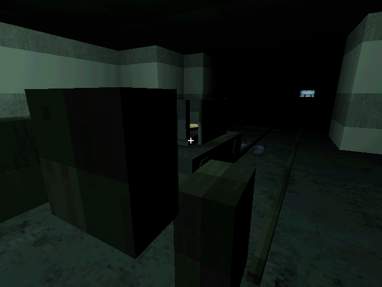
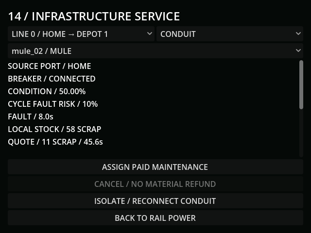
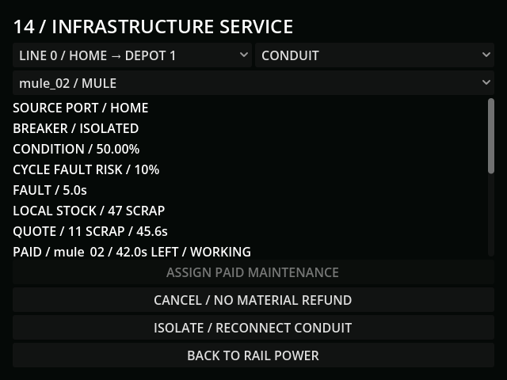
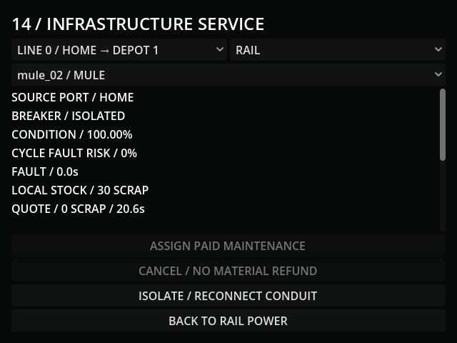

# M39 — Infrastructure condition and maintenance

Verified 21 October 2026, Godot 4.7.2/Jolt and Godot AI 4.3.0, connected editor
`game-project@d5d2388e49bf2eb1`. Run `r4446382-7` verified the final reload fix
and completed the live repair/delivery scenario with clean current-run logs.
Fresh run `r5064194-8` reloaded the completed state: canonical line keys, no
pending jobs, restored connectivity, the torch hull and conserved fuel stock.
All live saves use `user://tests/m39_live_20261021.json`.

- Started from the isolated M38 route/FOB fixture. Prepared a real additional
  home hull through the existing paid pipeline: Mule frame 40 scrap/120 funded
  steps, torch 14 scrap/30 funded steps, actual clear-bay assembly and fitting.
  Home scrap changed 112 → 58. Grid charging, including steps during torch
  fabrication and another 60 charging steps, left the new `mule_02` at
  0.049444kWh in the actual home bay. No hull was teleported from the field.
- Controlled deterioration (not a claim of waiting through campaign hours):
  set rail to 20 and conduit to 50. A real fuel rule loaded two units and ran
  the physical car for 3.2 real seconds. It moved 1.866667m at the low-band
  0.583333m/s, instead of the fresh 2m/s. Real movement reduced rail condition
  to 19.998115. With generation off for one measured paid step, demand was
  3.674kW, including 0.119kW loss; actual battery debit matched
  3.674/3600 = 0.001020556kWh.
- A controlled eight-second rail jam held car position and paid reserve while
  healthy wire remained live. A separate wire short cut downstream service and
  requested 2kW. The terminal's source breaker removed that short draw without
  erasing the loaded cargo or paid car reserve.
- The actual maintenance terminal selected `mule_02` and assigned conduit work.
  It charged 11 local scrap once (58 → 47); the quote used actual fractional
  wear and the same ceiling rule as part repairs. Three real powered seconds
  reduced the base work from 45.615184 to 42.015184 seconds at fresh torch
  efficiency. The hull was reserved and transfer/fitting/other jobs were blocked.
- Reload retained the paid work and motor reserve. Three deliberately unfunded
  steps with a stale saved supply fraction made no repair progress. Restoring
  finite generator supply completed the remaining conduit work in 36 stepped
  grid seconds. Conduit returned to 100, the manual breaker stayed isolated,
  and a real save succeeded.
- The same hull then serviced the rail for 17 scrap (47 → 30), completing
  60.615210 base seconds in 51 supplied steps and restoring rail to 100.
  Reconnecting the source breaker restored the route. The first fully paid
  motor second moved 2m; another 60 grid steps under the finite generator
  completed the retained delivery. Home fuel 58 + depot fuel 2 remained 60,
  the car was empty, and subsequent travel resumed ordinary wear.
- The first live completion after JSON reload exposed a numeric-key bug:
  saved edge 0 became float 0.0 and completion wrote a separate key. Save
  validation rejected that inconsistent state and preserved the previous
  valid save. Edge normalization and canonical completion keys fix it. Tests
  now finish and save both rail and conduit jobs after an actual JSON reload;
  the repeated live scenario restored the original key and saved successfully.
- Tests also prove exact condition boundaries, payload/distance wear, separately
  priced downstream losses, partial motor payment, shorts and manual isolation,
  seeded cycle partitioning, weather/radio independence, distinct component
  connectivity, upstream access despite a far outage, held/cancelled/lost work,
  local stock, parallel hull reservations, other-hull action dispatch and v32
  migration without repairing old rail for free. Wire/rail faults and their
  clocks/RNG, switches, cargo and already-paid jobs persist in save v33.
- Terminal min 388×280; bottom button ends at Y464 in the 640×480 framebuffer.
  The car context image uses a temporary diagnostic camera; terminal screens
  are actual game UI. All world surfaces remain the verified PSX pack assets.
- Final full regression: **199 tests / 2,079 assertions**, all passed. Final
  infrastructure suite: **14 / 161**, all passed. Import/diff checks and final
  fresh-run state/log checks passed. Accelerated fixtures do not establish the
  human maintenance burden or campaign pacing.
- Default save SHA256 stayed
  `5FF9FCFA19414DF1A8E20847B69DA45BCF96C48330B4E1CD9AF59DE603211D75`.

