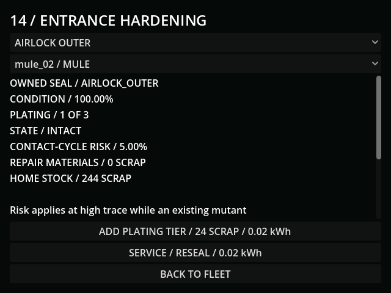
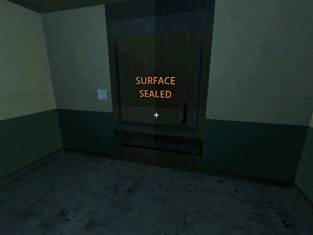
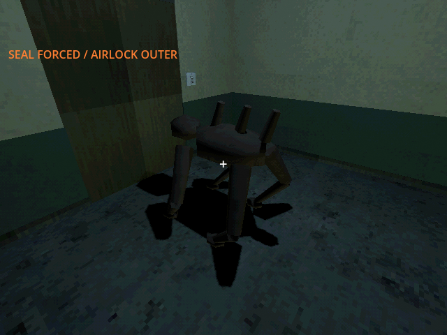
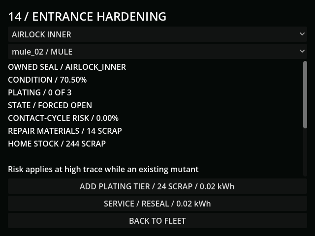
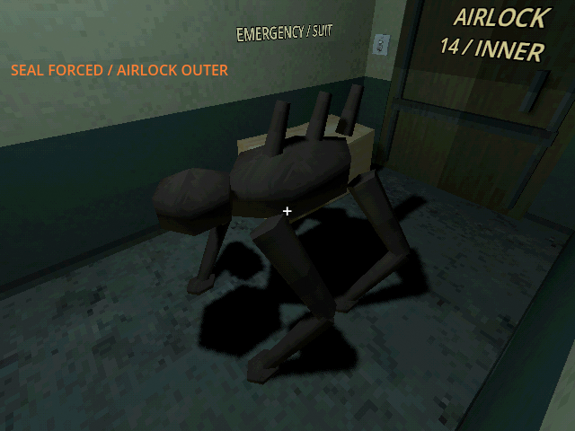
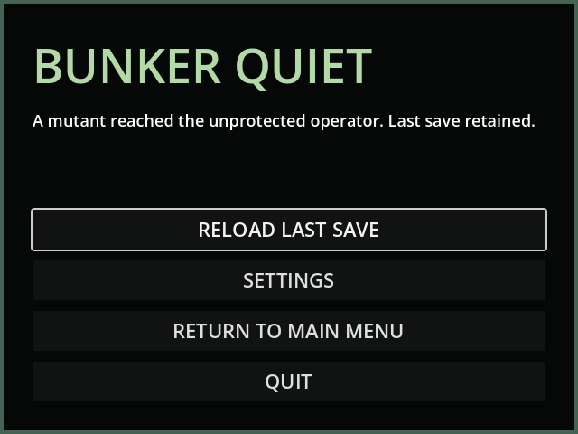

# M40a — Underground trace and two-seal airlock forcing

Verified 21 October 2026 with Godot 4.7.2/Jolt and Godot AI 4.3.0, connected
editor `game-project@d5d2388e49bf2eb1`. Final fresh run `r8922372-10` reloaded
the ingress state, reproduced the actual operator death and retained the last
valid save, with clean current-run logs. All live saves used
`user://tests/m40a_live_20261021.json`. This is the first M40 checkpoint;
physical rail mouths and weakened lining remain required in M40b.

- Paid excavation records a vibration pulse every five supplied work seconds
  at the current tunnel front/room, including muffled sensing through cover.
  A real drill/tender GUT scenario proved no unfunded progress/noise, saved its
  partial four-second clock, and emitted once after the next funded second,
  adding 1.8 trace. Actual rail movement likewise records ten-metre pulses,
  with saved partial distance and real payload scaling; idle/blocked motion is
  silent. The live car emitted a below-grade rail pulse at approximately
  E7.292, N115.089, Y=-5, reach 80, with 2.936m left in its next distance cycle.
- Controlled prerequisite fixture: inherited the M39 held network/torch hull,
  supplied a recovered defense archive and starting resources, then actually
  paid 32 scrap/300 grid steps for defense research and charged the service
  hull. The live plating button spent 24 scrap and 0.02kWh, leaving 244 scrap.
  At the controlled trace 100, the intact outer seal's per-contact-cycle risk
  fell from 15% to 5%, staying positive. Its native PSX metal plate was rendered
  before acceptance. No new raster/sound asset was used.
- An existing mutant archetype was staged outside at N16 as a pressure fixture,
  then walked under its own controller to N11.6 and physically struck the seal.
  The first tier reduced strike wear to 2.25 condition points. Six accelerated
  ten-second contact cycles forced the actual outer collider open; they created
  no additional actor. In 3.5 real seconds the same body crossed the aperture
  into the vestibule, stopping at N7.567 against the intact inner collider.
- Reload retained that body's position, route stage, seal state and RNG. Four
  more contact cycles separately forced the inner seal. After 0.65 real seconds
  the body occupied the inner aperture near N6.137. Resealing rejected that
  actual overlap and spent no material or energy.
- Another 1.1 real seconds carried the body into the bunker near N3.680.
  With the aperture now clear, service spent 14 scrap and 0.02kWh and restored
  its inner collider behind the intruder. That did not remove an existing body
  already inside. Ordinary senses and physical walking brought it to the bare
  operator; the recorded cause was "A mutant reached the unprotected operator."
  The world paused, saving was rejected, and the prior valid save stayed
  byte-identical. The death screen now retains that actual cause even when a
  failed save is attempted, instead of replacing it with a life-support label.
- Tests cover risk bounds and nonzero fully plated risk, no remote/stunned/
  covered forcing, real two-collider crossing, local scrap/finite hull energy,
  tender transfer loss, maximum tiers/cooldowns, occupied sealing and corpses,
  normal interlock denial with an opposite failed seal, contact/RNG/route
  reload, v33 migration, bare surface exposure and last-good-save protection.
  Intact static barriers reduce risk; their stronger energized discount requires
  fresh paid power and resets on restore. Light/stun, decoys and existing
  perimeter/siege behavior remain active rather than being bypassed by a roll.
- The terminal fits 640×480; native door/actor views use temporary diagnostic
  cameras, while terminal and death screens are actual game UI. GUT also checks
  its minimum size and bottom button against the real framebuffer.
- Full regression: **210 tests / 2,180 assertions**, all passed. Final focused
  breach/defense/life-support checks passed after the final cause/protection
  changes; final counts are recorded in the build log. Import and diff checks
  passed. Accelerated contact cycles do not establish human encounter balance.
- Default save remained unchanged, SHA256
  `5FF9FCFA19414DF1A8E20847B69DA45BCF96C48330B4E1CD9AF59DE603211D75`.

