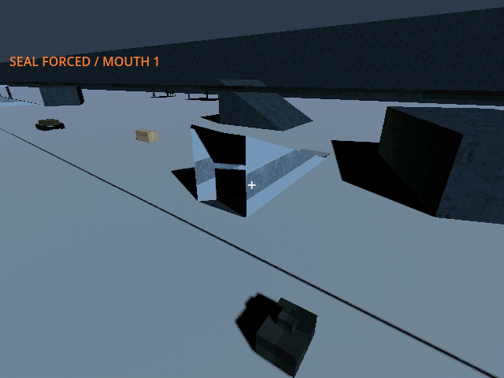
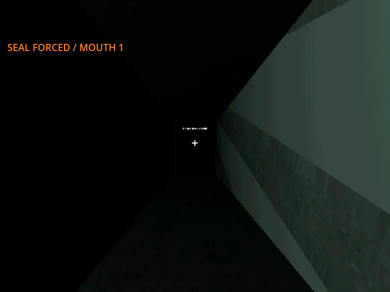
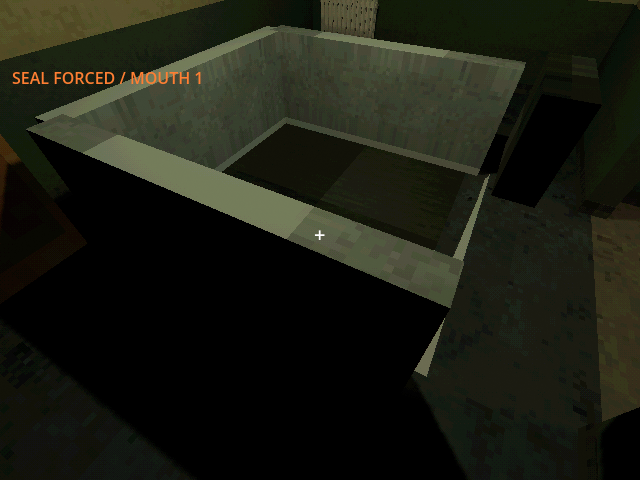
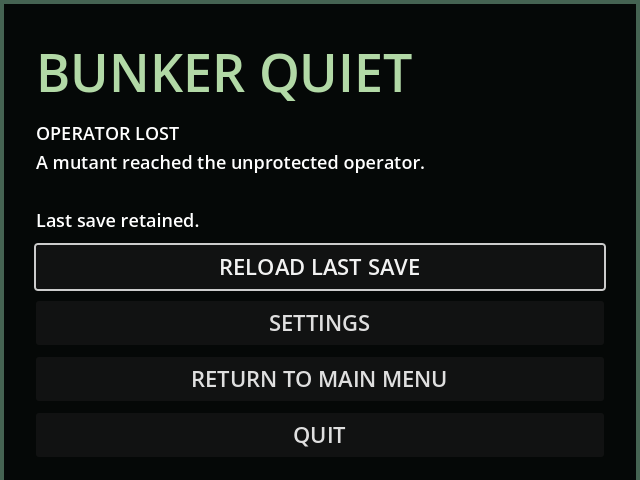

# M40b — Physical rail mouths, thin lining and service hatch ingress

Verified 23 October 2026 on Godot 4.7.2/Jolt through Godot AI 4.3.0,
session `game-project@8118846c96a7f877`. Native final run `r1056143-3`
loaded save v35 and reported a live helper with clean current-run logs.
All live changes used `user://tests/m40b_live_20261023.json`.

- Each completed held-hub segment commissions a fixed rail mouth and a
  midpoint service chase. Native textured solid slabs form two 9m ramps and
  a landing, with real ground apertures and separate seal colliders. Fixed
  saved anchors survive widening; cleared volume reduces new excavation
  quotes. Previously paid v34 work retains its original price and duration.
- A controlled existing-archetype actor began outside mouth 1 at E9.5,
  N119. Four accelerated ten-second contact cycles forced the top seal.
  Actual controller/collision movement carried it around the switchback to
  E10.269, N122.898, Y=-6, inside the earned tunnel. Save/reload retained its
  exact pose and stage 2/waypoint 4 route. No probability roll moved it inside.
- A second controlled actor began outside the unsealed wall-0 chase. Actual
  descent stopped at E8.527, N68.986, Y=-5.469, in contact with intact lining.
  One seeded contact cycle forced it. Actual movement then crossed into the
  network at E5.697, N64.626, Y=-6. Both actors and routes survived a fresh
  game-process restart and v35 reload.
- The same wall actor walked the earned tunnel home, reached the service
  ladder, and climbed continuously with swept collision. The closed hatch
  stopped it at climb progress 3, E0/N-8/Y=-1.5. A separate contact cycle
  forced that barrier. Continuing the same physical actor reached Y0 and
  stage 3, then triggered "A mutant reached the unprotected operator."
  The death menu retained the last valid save. Movement used 4x simulation
  time for bounded diagnostics; this does not establish encounter pacing.
- Portal lamps require fresh source-port payment (0.02kW each). Final native
  review corrected a lamp embedded in the partition by moving it into the
  landing. Local stock, finite torch energy, wire outage, risk attribution,
  ladder/route persistence, solid roof collision, stable layout and paid
  widening quotes are covered by the focused ingress suite. Roof shader
  clipping uses owned volumes; rendered ramp/roof geometry uses existing
  PSX surface materials, with no new bitmap assets.
- Full regression before the final legacy-job extension: **219 tests /
  2,253 assertions**, all passed. Final focused migration/ingress results
  are recorded in the build log. The extension preserves already-paid v34
  widening work across migration and a subsequent v35 save/reload.
- Default save SHA256 remained
  `5FF9FCFA19414DF1A8E20847B69DA45BCF96C48330B4E1CD9AF59DE603211D75`.

Screenshots use temporary native diagnostic cameras except the actual death UI.

