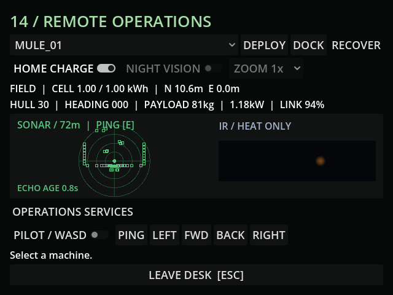

# M41 — Native operational and threat audio

Verified 23 October 2026 on Godot 4.7.2 with WASAPI through Godot AI 4.3.0,
session `game-project@8118846c96a7f877`. Final fresh runtime `r1816946-5`
reported a live helper and clean current-run logs. All live save operations
used `user://tests/m41_live_20261023.json`; default save remained unchanged.

- Fifteen deterministic synthesized PCM cues are cached in memory. No foreign
  recordings or pack music were introduced. Fade/headroom tests cover every
  cue. Native Effects/Ambience buses obey existing settings through Master,
  with a -1dB limiter for overlapping voices.
- Native AudioEffectCapture measured an isolated near-left chirp at RMS
  L=0.131822/R=0.065911; the corresponding right source reversed those values.
  A centered source 8.8m down the corridor measured 0.007009 in both channels.
  A source behind the workshop wall measured L=0.002827/R=0.001774 and reported
  covered=true. These are captured engine mixer samples, not inferred pan
  properties. Temporary capture effects were removed afterward.
- Actual moving mule speed was 3.60m/s with sound reach 8m. Silent running
  reduced actual movement to 1.26m/s and acoustic reach to 2m. The listener
  followed its sensor eye at a 94% link. Tests additionally cover dead cells,
  thermal-siphon silence, listener rotation and blackout return to bunker.
- Successful live sonar produced its chirp and delayed geometry echo. A
  controlled organic actor physically moved nearby, producing positional
  claw steps. The next real ping measured one fresh hostile contact and
  produced the separate delayed contact tone. Cooling-down/silent pings and
  leaving the linked feed do not create stale echo information.
- Moving-world Effects capture measured RMS 0.079809; pausing yielded exactly
  zero over 14,336 captured frames. A separate Master-bus check measured
  0.113342 unmuted and zero after Effects mute. Previous mute settings were
  restored without writing the user's settings file.
- Weather follows the actual condition and owned indoor classification;
  ventilation stops without supplied O2 circuitry. Life warnings and the
  faster critical cadence, suit breath and oxygen/filter urgency, distance/
  cover bounds and pause/reload are covered by gameplay tests. Presentation
  subscribes to physical emissions without adding AI events or changing trace.
- Full regression: **226 tests / 2,413 assertions**, all passed. Final audio
  suite after explicit cue attribution/limiter: **7 / 153**; final existing
  mutant sensing/physical interaction suite: **6 / 51**, all passed.
- Default save SHA256 stayed
  `5FF9FCFA19414DF1A8E20847B69DA45BCF96C48330B4E1CD9AF59DE603211D75`.

Capture proves working mixing/routing; subjective timbre, tension and comfort
still require human listening/playtesting. Screenshot shows the actual native
640×480 terminal during the audible sonar scenario.

