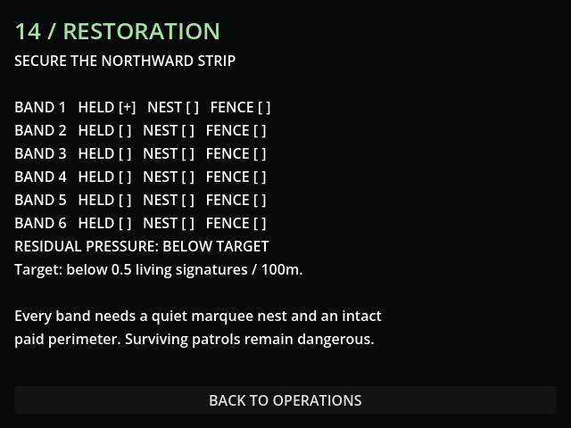
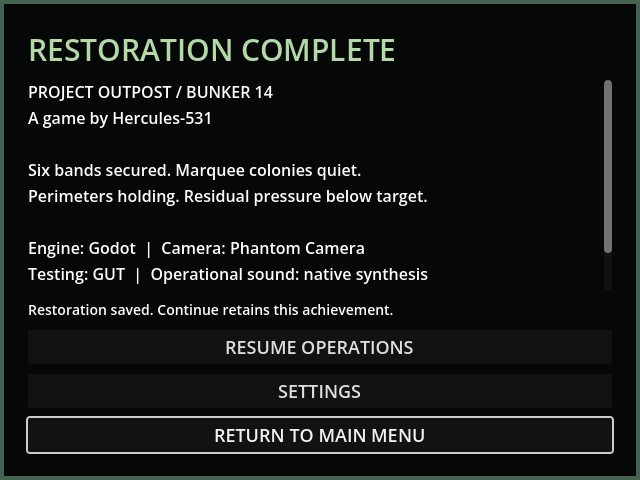

# M42a — Restoration checklist and exactly-once ending

Verified 23 October 2026 on Godot 4.7.2 through Godot AI 4.3.0, session
`game-project@8118846c96a7f877`, native run `r2399736-6`. Current-run logs
reported a live helper without gameplay errors. The actual checklist and
credits fit the native 640×480 framebuffer.

- The new checklist reads earned territory, each marquee nest's permanent
  state and all five physical perimeter sections in each of six bands.
  It reports aggregate residual pressure against the strict <0.5 living
  signatures/100m target, without revealing hidden enemy locations/counts.
- Native controlled completion fixture: all six held sites had matching
  perimeter records, nests received real damage and the existing scout was
  killed. The last section of band 6 remained broken. Evaluation correctly
  refused completion; the precompletion state was schema-valid and saved.
  Restoring that last section triggered credits, paused simulation and
  persisted one completion with credits acknowledged in save v36.
- Settings opened from credits and returned correctly. Resume Operations
  resumed simulation. Continue reloaded completed=true/credits_seen=true;
  evaluation did not award again, no automatic credits opened, and the
  presentation counter remained one. The saved completion time in this
  fixture was 24.533 simulation seconds, not campaign playtime.
- Tests independently remove each band, nest requirement and each fence
  section. Exactly three survivors (density 0.5) block completion; killing
  one permits it and dead bodies do not count. Death, malformed records and
  timestamps beyond elapsed time are rejected. A failed save leaves credits
  visibly unsaved/retryable; restoring a valid path persists them without
  another completion. An unacknowledged ending presents once on Continue.
  v35 saves migrate without a fabricated achievement.
- Full regression **233 tests / 2,514 assertions**, all passed. Restoration
  suite **7 / 101** includes pause/settings/reload and both saved/unsaved UI
  states fitting 640×480. Native review confirmed readable complete layouts.
- Every live save used `user://tests/m42a_live_20261023.json`. Default save
  remained byte-identical, SHA256
  `5FF9FCFA19414DF1A8E20847B69DA45BCF96C48330B4E1CD9AF59DE603211D75`.

This fixture validates ending logic, not authored campaign content or the
40-hour target. The six separate band checkpoints and human playtests remain.

