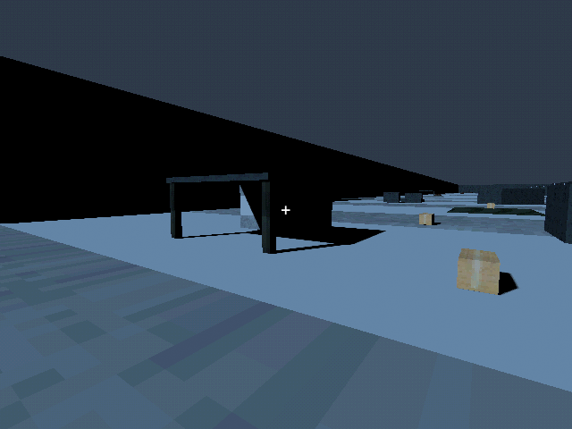
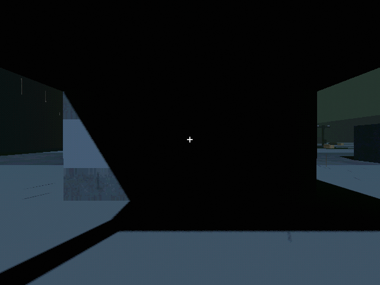
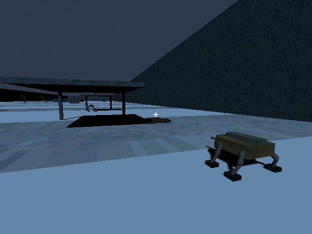

# M42b — Authored band 01: Approach

Verified 23 October 2026 on Godot 4.7.2/Jolt through Godot AI 4.3.0,
session `game-project@8118846c96a7f877`. Final fresh native run
`r3443062-8` reported a live helper and clean current-run logs.

- The first band preserves the opening camera, archives and pylon spine.
  It adds two native PSX-textured service shelters and eighteen finite PSX
  box loads: 192 scrap, 80 fuel and six rations in total. No pickup grants
  research, territory or stock. Existing original supplies remain unchanged.
- The actual starter mule controller drove all five authored waypoints,
  stopping at E47.413/N90.000, 9.019m from the marquee nest. This used 8x
  simulation time with power/weather/AI roots held for geometry verification;
  it does not establish sortie energy or encounter balance.
- A second controlled equipment fixture provided CCD/sentry fittings at home,
  paid ten scrap for twenty rounds through the existing reload action, and
  used the actual loader/deployment and same physical route. Observed fire
  orders cleared the 200-integrity nest in five rounds, leaving fifteen rounds
  and 0.99kWh. Its permanent state, ammo and battery survived Continue. Frontier
  remained zero: clearing the nest did not claim the next band.
- A fresh baseline loadout physically drove to the first new scrap crate and
  back to the airlock. Pickup kept inventory at 80; the real return loader
  delivered sixteen scrap, producing 96. Saving and Continue retained the
  delivered state. Live fixtures used separate `user://tests/m42b_live_20261023.json`
  and `user://tests/m42b_logistics_20261023.json` slots.
- Native shelter and nest review reused verified PSX house textures/box props.
  Rain clipping now includes authored shelter roofs, with capacity for all six
  bands plus earned entrances. Fresh native rain review shows streaks outside
  and a clear covered interior. No new bitmap or external audio was introduced.
- Initial regression found crates obstructing the home perimeter and a future
  chase ramp. Both were relocated. Actual home footprint clearance, authored
  placement guards and the full physical ingress suite verify the corrections.
  Current unbuilt pad footprint queries were clear across all six bands.
- Save v37 records authored-band count. Old collected/carried/delivered items
  retain state; only newly authored sites are added. Tests cover finite mass,
  real loader/reload conservation, legacy migration, missing known records and
  invalid content versions. Existing legacy buried-cache coverage remains.
- Default save remained unchanged, SHA256
  `5FF9FCFA19414DF1A8E20847B69DA45BCF96C48330B4E1CD9AF59DE603211D75`.

Final regression: **237 tests / 2,596 assertions**, all passed. The campaign
suite contributes **4 / 82** and physical ingress **8 / 72**.
Band 02–06 content and human campaign pacing remain later checkpoints.

