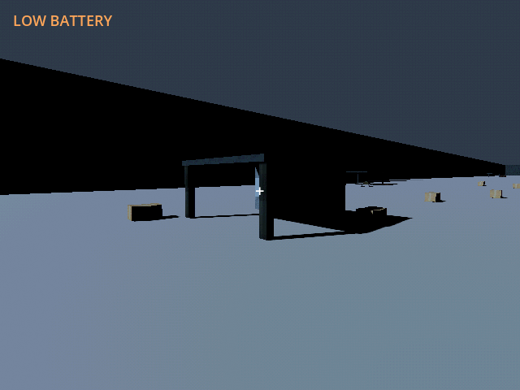
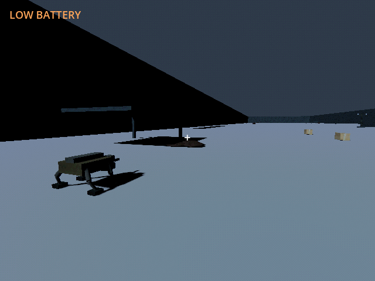

# M42c — Authored band 02: Buffer

Verified 23 October 2026 with Godot 4.7.2/Jolt and Godot AI 4.3.0, native
session `game-project@8118846c96a7f877`, fresh run `r4097330-10`.

- Added two PSX-textured shelters and 23 finite supply loads: 336 scrap,
  240 fuel and twelve rations. Per-load reward/bulk and actual nest integrity
  rise northward; the existing 3300s independent clock is shorter than band 1.
  The route flanks existing rubble and the first earned pad to a west nest.
- Focused checks: campaign **6 tests / 164 assertions**, defense **7 / 95**
  and physical ingress **8 / 72**, all passed. These cover both driven band
  routes, finite stock/mass, additive content migration, adjacent-only claims,
  pad footprints, actual seal/ramp/climb behavior and paid defenses. The prior
  M42b full regression was 237 / 2,596; no new full-suite result is claimed here.
- Initial route checks found two crate obstructions. Relocation and a generic
  1.8m route-placement margin resolved them. An earned lining roof previously
  made later fence planning reject its own foundation. Posts now accept owned
  solid lining; gates/foreign obstructions still reject construction. A physical
  commissioned-tunnel fixture verifies both acceptance and foreign-box rejection.
- Native fixture inherited the M39 earned first hub/tunnel. Provided CCD/sentry
  fittings and ten paid scrap supplied twenty rounds. The actual starter
  controller drove all eight points, stopping at E-42.435/N170.712. Seven
  observed fire orders cleared the 300-integrity nest, leaving thirteen rounds
  and 0.986kWh. Frontier remained one. Source-pad perimeter clearance was true
  after physics synchronization. Simulation ran at 8x with other systems held;
  this is geometry/objective verification, not an energy or campaign pacing test.
- Continue retained the cleared nest, ammo and two-band content version.
  Native shelter/nest screenshots were fresh; roof clipping registered eleven
  volumes including inherited entrances. Current-run logs were clean.
  Only `user://tests/m42c_live_20261023.json` received live writes; the M39
  fixture was read as a prerequisite and not overwritten.
- Default save SHA256 remained
  `5FF9FCFA19414DF1A8E20847B69DA45BCF96C48330B4E1CD9AF59DE603211D75`.

