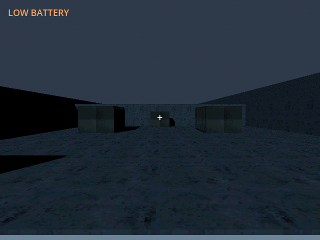
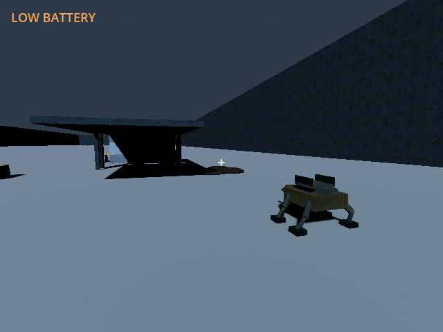

# M42d — Authored band 03: Substation

Verified 23 October 2026 with Godot 4.7.2/Jolt through Godot AI 4.3.0,
session `game-project@8118846c96a7f877`, fresh run `r4462776-12`.

- Third-band content adds two shelters and 25 finite loads: 640 scrap,
  360 fuel and fifteen rations. Its ten-point route enters/exits the existing
  substation opening, reaches the archive and approaches the eastern marquee
  nest. Existing archive/artifact and substation geometry were preserved.
- Campaign **6 tests / 250 assertions** and research **5 / 73** passed.
  Checks include all three physically driven routes, per-band pad clearance,
  strict reward/danger ordering, archive reach, finite stock/load conservation,
  additive migration and actual research cargo/power/prerequisite behavior.
- Native controlled late-game fixture inherited the prior saved hub and
  provided the next earned pylon/FOB for this leg's link coverage. A provided
  rack and a paid twenty-round refill supported the actual mule's ten-point
  drive. It stopped at E42.371/N268.942 and used nine observed shots to clear
  the 400-integrity nest. Twenty-four rounds and 0.968kWh remained; frontier
  stayed at the fixture's value two. Continue retained nest, rounds and energy.
- That inherited fixture had already delivered the heavy archive. A separate
  fresh-run archive fixture therefore checked real pickup at the authored
  approach: one physical kilogram attached to the mule, stock stayed 80,
  heavy research stayed locked, and Save/Continue retained the carried book.
  No previously delivered archive was reset or credited in the inherited run.
- Geometry/objective motion used 8x simulation time with other systems held,
  not a campaign energy/pacing claim. Native substation/nest screenshots are
  fresh; current-run game logs were clean. Writes used isolated
  `user://tests/m42d_live_20261023.json` and
  `user://tests/m42d_archive_20261023.json`; prerequisite fixtures were read only.
- Default save remained unchanged, SHA256
  `5FF9FCFA19414DF1A8E20847B69DA45BCF96C48330B4E1CD9AF59DE603211D75`.

