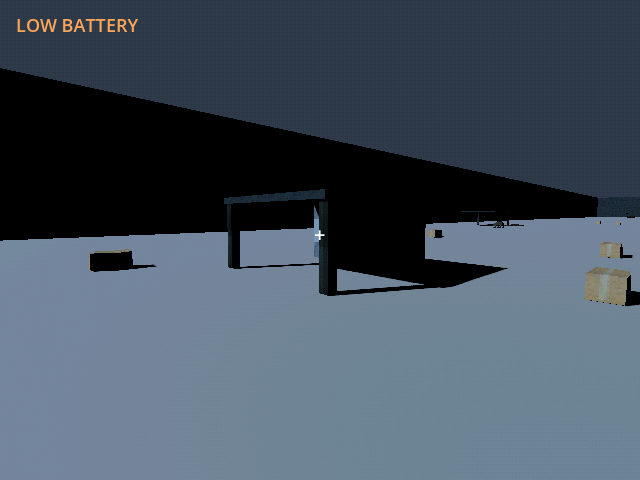
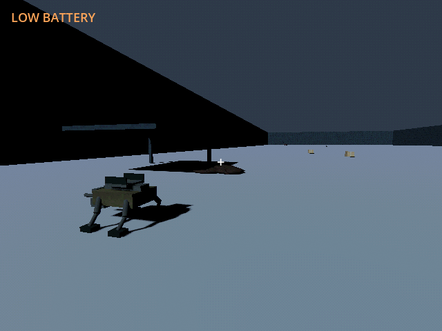

# M42e — Authored band 04: Excavation frontier

Verified 23 October 2026 with Godot 4.7.2/Jolt through Godot AI 4.3.0,
session `game-project@8118846c96a7f877`, final fresh run `r4903479-14`.

- Added two PSX shelters and 27 finite loads: 1,008 scrap, 480 fuel and
  eighteen rations. Bulk rises to 84kg per scrap load. The eleven-point
  route reaches the physical excavation archive/neural artifact and west nest.
- Campaign **6 tests / 343 assertions** passed: all four driven routes,
  actual objective reach, ordered reward/nest strength/clocks, finite cargo,
  construction clearance, additive migration and lining integration.
  A fresh-world route exposed the uncollected book blocking the direct exit;
  the final route physically flanks it and passes without requiring pickup.
- Native fixture provided the next held pylon/FOB for link coverage. The
  controller completed the final eleven-point route to E-41.501/N360.995.
  Eleven paid observed rounds cleared the 500-integrity nest, leaving thirteen
  rounds and 0.946kWh; frontier stayed three. The final route was rerun after
  the detour change without consuming additional rounds. Reload retained the
  completed nest/ammo/energy before that final fresh run.
- A separate fresh pickup fixture collected the excavation book as 1kg.
  The winch correctly rejected taking a second item simultaneously. Providing
  a rack allowed the neural artifact as the second kilogram; Save/Continue
  retained both carriers. Research remained locked and the artifact remained
  cargo, with no duplicate reward or automatic socket effect.
- Native shelter/nest screenshots are fresh and logs are clean. Motion used
  8x simulation with other systems held, not a campaign balance claim. Only
  `user://tests/m42e_live_20261023.json` and
  `user://tests/m42e_pickup_20261023.json` received live writes.
- Default save stayed unchanged, SHA256
  `5FF9FCFA19414DF1A8E20847B69DA45BCF96C48330B4E1CD9AF59DE603211D75`.

