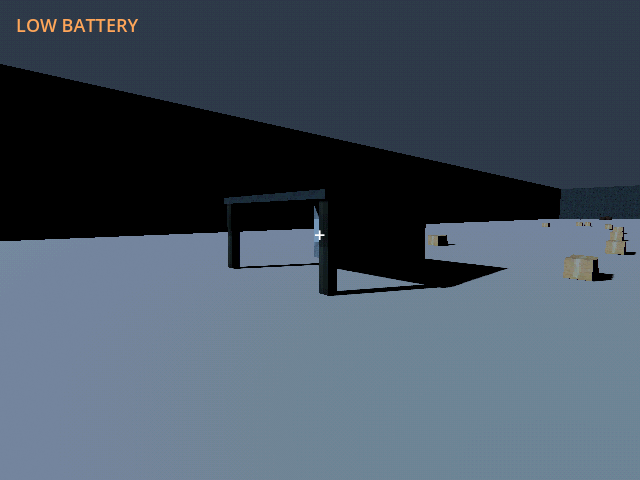
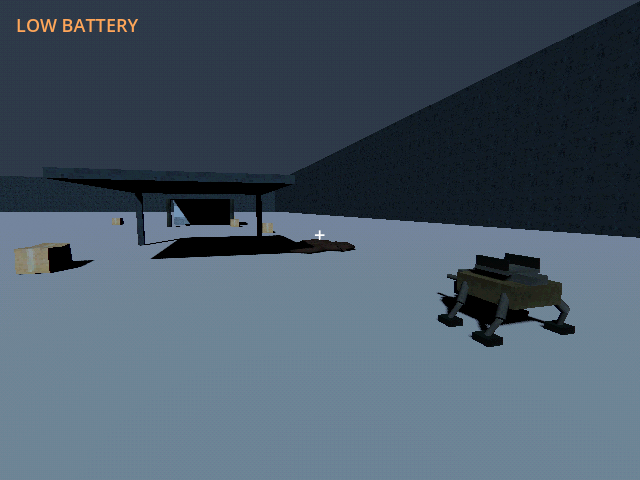

# M42f — Authored band 05: Optical frontier

Verified 23 October 2026 on Godot 4.7.2/Jolt through Godot AI 4.3.0,
session `game-project@8118846c96a7f877`, fresh native run `r5159348-15`.

- Added two PSX shelters and 29 finite loads: 1,440 scrap, 600 fuel and
  twenty-one rations. The twelve-point route reaches the original optics
  archive/photonic artifact and eastern nest. New supplies clear the earned
  pad, future apertures and route margins.
- Campaign **6 tests / 442 assertions** passed, including all five physically
  driven routes, discovery reach, additive content/reward retention, real
  northward strength/clocks and construction/lining integration.
- Native fixture provided the next held pylon/FOB, preserving the existing
  chain for this leg's link. The actual mule completed twelve points to
  E40.005/N460.574. Thirteen paid observed rounds cleared the 600-integrity
  nest, leaving zero rounds and 0.920kWh. Frontier remained four. Continue
  retained the cleared state and empty magazine. The light hull explicitly
  rejected a 108kg load through the real cargo rules.
- A separate fresh fixture collected the optics archive and photonic device
  with a rack. Save/Continue retained both as carried and two kilograms of
  cargo; optics research stayed locked and the device was not socketed.
- Screenshots are fresh native shelter/nest views, and game logs are clean.
  Geometry/objective movement used 8x time with other systems held, not a
  campaign energy/pacing verdict. Live writes used only
  `user://tests/m42f_live_20261023.json` and
  `user://tests/m42f_pickup_20261023.json`.
- Default save remained unchanged, SHA256
  `5FF9FCFA19414DF1A8E20847B69DA45BCF96C48330B4E1CD9AF59DE603211D75`.

