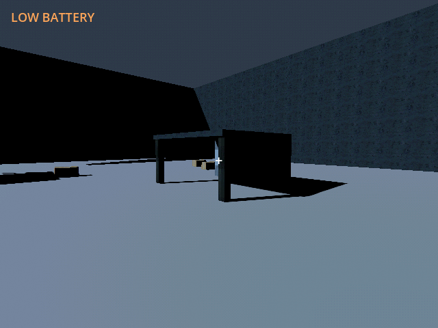
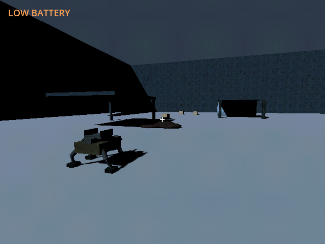

# M42g — Authored band 06: Northern terminus

Verified 23 October 2026 with Godot 4.7.2/Jolt through Godot AI 4.3.0,
session `game-project@8118846c96a7f877`, fresh native run `r5404601-16`.

- Final content adds two PSX shelters and 31 finite loads: 2,112 scrap,
  720 fuel and twenty-four rations. The six-point route approaches the final
  700-integrity marquee nest; independent growth interval is 2100 seconds.
  All six authored resources are registered in order within the finite strip.
- Full import/regression: **239 tests / 3,059 assertions**, all passed.
  Campaign contributes **6 / 545**, including all six physically driven routes,
  resource bounds/IDs, actual reward and nest-pressure ordering, objective
  reach, finite payload/loader conservation, additive save versions and pad/
  lining clearance. Restoration and the earlier systems remain green.
- Native fixture provided the next held pylon/FOB for this leg. A real paid
  refill spent the final ten fixture scrap for twenty rounds. The controller
  completed all six points to E-39.247/N568.987, then fifteen observed fire
  orders cleared the nest. Five rounds and 0.890kWh remained; frontier stayed
  five. Save/Continue retained the cleared nest and ammunition.
- Current native content reports 18/23/25/27/29/31 added loads by band and
  nineteen roof-clipping volumes with the inherited entrances. Native final
  shelter/nest screenshots were fresh; current-run logs were clean.
  Geometry/objective motion used 8x simulation with other systems held, not
  an actual campaign energy/40-hour pacing result.
- Writes used only `user://tests/m42g_live_20261023.json`; prerequisite
  fixtures were read only. Default save remained unchanged, SHA256
  `5FF9FCFA19414DF1A8E20847B69DA45BCF96C48330B4E1CD9AF59DE603211D75`.

Six-band content is implemented. The campaign balancing/human-playtime and
export/release acceptance checkpoints remain separate required work.

