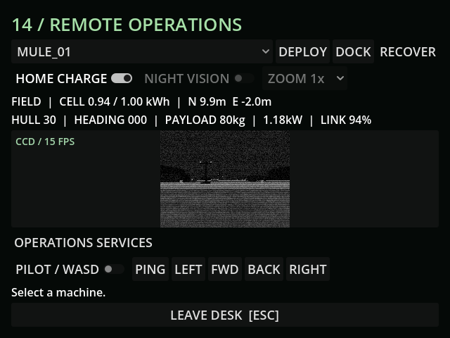

# M43a — Opening scenario and isolated playtest candidate

Verified 24 October 2026 with Godot 4.7.2/Jolt and Godot AI 4.3.1,
session `game-project@d4998873cf9f44e2`.

## Implemented behavior

- The integrated GUT opening drives the actual delayed command link and
  CharacterBody controller. Two physically returned loads deliver sixteen
  scrap and the first camera. Loader transfers consume their normal duration;
  all systems except the held sunlight weather clock remain active.
- The camera stays blind while carried. Workshop fitting uses the recovered
  serial/condition, grants Tier 1 and survives reload alongside paid energy,
  joint condition and inventory. Fabricating the CCD shortcut is rejected.
- `--playtest` selects separate save/settings files before startup reads them.
  Explicit test save slots retain their identity. Normal launches keep the
  regular outpost profile. Both exported profiles are checked by the verifier.
- The packaging script includes executable, PCK, profile-selecting launcher
  and SHA256 manifest. The local ZIP is a playtest candidate; release signoff
  and human campaign pacing remain pending.

## Native verification

Fresh run `r305518-1` loaded an isolated opening fixture, deployed through the
actual loader, then accepted two seconds of forward steering. The Mule reached
E-2.0/N9.94, with battery 0.9466150803 kWh, joints 99.12737381, sixteen delivered
scrap (96 total) and the recovered Tier 1 camera. It saved only to
`user://tests/m43a_live_20261024.json`.

Fresh run `r458617-2` loaded that new save and retained those values, position,
deployed state and delivered camera. The MCP game screenshot was fresh at
640×480, showing the actual CCD/15 FPS feed. Current-run game logs contained
only the bridge registration; no runtime errors. Existing editor lint warnings
remain. The first run's diagnostic screenshot save initially failed because
the evidence directory did not exist; creating it resolved the capture error.

## Acceptance limits

Final import, regression and Windows release export passed: **242 tests /
3,105 assertions**, all passed in 268.141 seconds. Both exported runtime probes
advanced process/physics frames and reported the correct `default` or `playtest`
profile, without the development bridge. One probe reported four exit-time
AudioStreamWAV/AudioStreamPlaybackWAV instances; verbose reproduction confirms
the audio teardown warning. It remains a final-runtime cleanup item for M44,
not an unreported clean-exit claim.

The automated opening covered 155.028 metres in 81.857 simulation seconds,
spending 0.0514623 kWh and 0.788134 joint condition. Fuel fell from 120 to 118.65,
rations from 8 to 7.955, and trace rose to 9.66453. Reload preserved the values.

`tools/package_playtest.ps1` produced the local
`builds/ProjectOutpost-Playtest.zip` with its isolated-profile launcher and
executable/PCK SHA256 manifest. Default save hash before and after all checks:
`D1672B59C9BBA66B5EEDF238CB4D831A2937E812B4DEAE07DABB1408BE4A4333`.

The opening is an automated 4x directed route with held sunlight, not a human
first hour. The separate one-hour life-support calculation advances only that
subsystem. No balance changes or 40-hour claims follow from either fixture.
Human feedback, campaign playtime, expansion/siege and underground/completion
passes remain required; see [playtest report](../PLAYTEST_REPORT.md).
