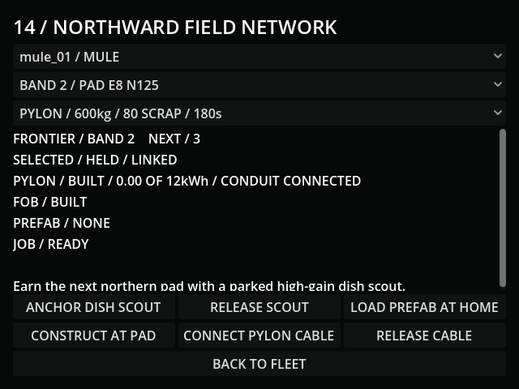

# M43b — Live expansion and siege recovery scenarios

Verified 24 October 2026 with Godot 4.7.2/Jolt and Godot AI 4.3.1,
session `game-project@d4998873cf9f44e2`.

## Scope and measurements

Two integrated GUT scenarios passed **2 tests / 56 assertions** in 68.388 seconds.
They use unique test saves. Research, initial stock, hulls, arriving prefab
convoys and the siege rally are provisioned fixtures, explicitly excluding
earning those prerequisites and travel time. Sunlight is held; other world
systems, physical attackers, power, wear, radio and work timers stay active.
Expansion runs at 8x and the siege at 4x simulation speed.

- Expansion anchors only the next pad, pays 80 scrap for a pylon and 150 for a
  FOB, and pays 20 scrap for forty defensive rounds. Actual work stops on tender
  disconnection. Save/Continue preserves the unfinished work and paid cargo;
  reconnection permits the normal live countdown to finish. A second home-paid
  prefab is provisioned at arrival and completes its full live FOB work timer.
- The unguarded fixture lost its tender. A loaded sentry facing the approaching
  patrol survives by issuing normal observed fire orders, with sonar/IR and
  actual ammunition/cooldown/link checks. No attacker is disabled or deleted to
  manufacture success. The defended run spends three rounds, leaving 37.
- At completion: 750 of the fixture's 1,000 scrap remains, fuel is
  111.716667, rations 7.723889 and tender charge 8.328084 kWh. The pylon/FOB are
  built and the wired/relay path is online. The small field bank is actively
  charging and serving nearby cells, not created full. Goliath/tender integrity
  remains 500/150. The directed fixture elapsed 497.502 simulation seconds.
- A separate fixture supplies the home perimeter and an existing known-home
  two-mutant pack at its rally. Real formation/approach/contact strikes occur
  while the live grid pays for the fence. The north section survives at 20/200;
  the other four remain 200. The pack is defeated, siege returns to idle, and
  Save/Continue retains the 299.933333-second cooldown and damaged perimeter.
  Fuel falls to 119.716667 and the operator remains alive.

## Native checks

Fresh MCP run `r1366497-3` loaded the completed expansion save, queried both
healthy hulls, 37 rounds, built structures and wired/online link, then wrote only
`user://tests/m43b_live_20261024.json`. Its 640×480 screenshot was fresh and
current-run game logs had no runtime errors. The siege save independently
loaded the idle/cooldown state, paid fuel, damaged live fence and living operator,
then wrote only `user://tests/m43b_siege_live_20261024.json`.

Default save remained unchanged:
`D1672B59C9BBA66B5EEDF238CB4D831A2937E812B4DEAE07DABB1408BE4A4333`.

The preceding opening/profile source also passed hosted import, **242 / 3,105**,
Windows export and both profile runtime probes on
[GitHub Actions run 40101481178](https://github.com/Hercules-531/Game_Project/actions/runs/40101481178).
The earlier failed run discarded its import error; failure diagnostics are now
printed and retained. No specific cause is claimed for that unreproduced failure.

This checkpoint establishes integrated automated costs/recovery, not an earned
expansion playthrough or human balance acceptance. Real convoy travel and
radio boundary coverage remain in their existing dedicated suites. Human
feedback, campaign time, M43c and final export acceptance remain pending.
