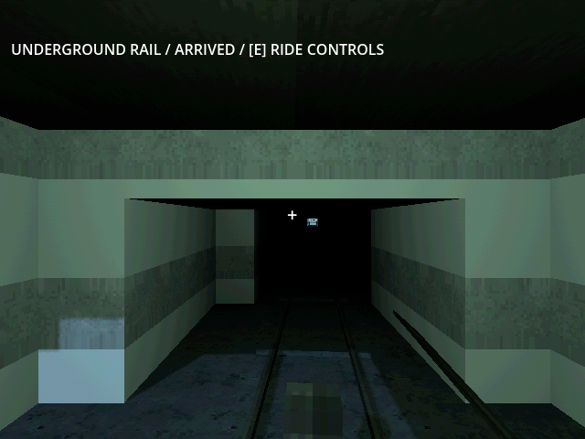

# M43c — Live underground operations, breach and completion

Verified 24 October 2026 with Godot 4.7.2/Jolt and Godot AI 4.3.1.
Three integrated GUT scenarios passed **3 tests / 108 assertions** in 189.742
seconds. No production balance constants changed.

## Declared fixtures and outcomes

Research, hull hardware, 1,000 initial scrap, a held forward pylon, and home/
field perimeters are supplied mid-campaign prerequisites. Defensive rounds,
excavation, freight car, passenger retrofit, freight and maintenance use normal
paid APIs and live timers. A field sentry issues observed shots through normal
sensor/link/cooldown checks. Other actors and world systems keep running.
Simulation uses 8x speed and scripted sunlight/aurora windows, not human time.

- In the secured-territory case, the two local nest sources start cleared;
  their residual actors remain live. A real room and northbound tunnel finish
  through a finite tender supply. Finished geometry commissions rail. The paid
  car delivers ten scrap while aurora disables radio, actual travel wears the
  track, and a reserved torch hull repairs it using paid scrap/grid work.
  Passenger retrofit, call, boarding, trip and disembarking complete physically
  below ground, without activating the hazard suit. Save/Continue retains all
  built infrastructure and paid values.
- At its saved end: 874 home scrap, ten depot scrap, 106.566667 fuel,
  7.552222 rations, tender 5.414831 kWh, 37 sentry rounds and track condition
  99.685601 after the passenger journeys. Directed simulation elapsed 806.696
  seconds; this is not an underground campaign duration estimate.
- The active-nest case runs the same operation with continuing recruitment.
  A supplied home fence alone, then a field sentry, and then a field perimeter
  were insufficient for an unattended operation through aurora. The final
  scenario explicitly verifies this failure: mutants force the forward rail
  mouth, physically reach the platform and kill the unprotected operator.
  Death pauses the world and Continue retains the valid pre-boarding save,
  including its remaining world danger. Enemies are not removed to pass this
  case, and reloading does not award a completed trip.
- A separate near-completion fixture supplies the campaign checklist except
  one broken home perimeter section. Completion stays false until a powered
  compatible hull repairs it for twenty real scrap. Credits pause once and
  the saved completion/seen flags survive Continue without automatic replay.
  This supplied checklist is not an earned campaign or playtime measurement.

## Native verification

Fresh MCP run `r2645831-4`, session `game-project@d4998873cf9f44e2`, loaded the
secured-territory save into an isolated target slot. It retained one room,
one tunnel, 874 home scrap and ten depot scrap. The operator boarded locally
at the forward station and rode to home in real rendered physics during aurora
with wireless range multiplier zero. Intermediate coordinate 50.41868 reached
zero; the operator stayed alive and underground at Y−5.4. The final arrival
saved successfully to `user://tests/m43c_live_20261024.json`; time scale returned
to 1.0. Current-run game logs had no runtime errors.

Default save before/after:
`D1672B59C9BBA66B5EEDF238CB4D831A2937E812B4DEAE07DABB1408BE4A4333`.

The preceding expansion source passed hosted **244 tests / 3,161 assertions**,
Windows release export and both runtime profiles on
[GitHub Actions run 40102138786](https://github.com/Hercules-531/Game_Project/actions/runs/40102138786).
Human campaign feedback, the approximately 40-hour comparison, and M44 final
runtime/release acceptance remain pending.
