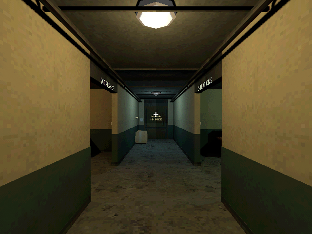
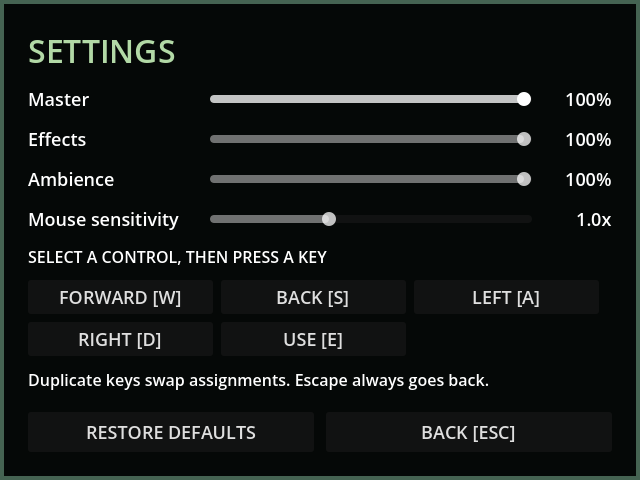

# M44 — Exported game-flow and release preparation

Verified 24 October 2026 with Godot 4.7.2, Godot AI 4.3.1 and Windows
D3D12/Forward+ on the RTX 5070 Ti. Automated technical acceptance passed;
human campaign acceptance remains pending.

- Complete import/regression passed **248 tests / 3,273 assertions** in
  527.012 seconds. The release-flow test exercises the same acceptance probe
  used in the shipped executable, with an isolated settings store.
- The release template rejects command-line scene overrides. A fixed opt-in
  `--verify-release` startup route now selects the packed diagnostic scene;
  normal startup is unchanged. This flag selects test settings before the
  autoload reads them. The probe instantiates its session with a test save
  path before startup, never redirecting a live default save after a write.
- Subsequent final exports passed **30 headless checks / 33 hardware checks**:
  actual New Game/Continue, live process/physics, paused simulation, visible
  settings, physical key binding and persisted volume, bus mute, native PCM,
  audio director and actual WASAPI mixer output, finite jumper rescue/timed
  docking, fleet/inventory/tunnel/depot persistence and saved credits once.
  Supplied infrastructure/ending fixtures are declared in the probe; M43
  separately establishes live construction, travel, maintenance and danger.
- Hardware capture is the exported executable's 640×480 framebuffer. Logs
  show D3D12/Forward+ and WASAPI at 48kHz. No final import, shader or runtime
  errors were found. The source shader retains perspective-correct defaults
  and snapping off; actual material policy enforces verified texture paths,
  ≤64px and no mips, with nearest sampling.
- Intermittent quick-exit audio warnings required stopping/nulling streams
  before teardown and a 0.1-second audio drain. Four repeated default/playtest
  probes and both final acceptance runs passed without leaked-instance
  warnings. The verifier now rejects those warnings as failures.
- Fresh native MCP run `r3882625-6`, session
  `game-project@d4998873cf9f44e2`, started an isolated new game, confirmed
  pause froze elapsed time, saved, opened settings and captured a fresh
  640×480 frame. Current game logs contained only bridge registration.

The rebuilt local playtest ZIP contains executable, PCK, isolated-profile
launcher, SHA256 manifest, third-party notice and five license files. Notices
cover the engine and 102 bundled-library entries, the pinned Phantom Camera
MIT license, and supplied Torment/SBS terms. PSX license verification is
deferred at the user's request; no terms or author are invented.

Final local candidate PCK SHA256:
`398BCFABD04E05D876457BE1F56641C291D302B66E668589C525F35119BE507E`.
Executable SHA256:
`D34D36F3BE1A6C49C56525AE86469B92E4F417DDF0B43CF00DD80C385C4B0562`.

Writes used `user://tests/release_probe/` and
`user://tests/m44_native_20261024.json`; playtest progress was not overwritten.
Default save before/after remained:
`D1672B59C9BBA66B5EEDF238CB4D831A2937E812B4DEAE07DABB1408BE4A4333`.

Hosted M43c run 40103797643 passed 247 / 3,269, export and artifact upload.
The final M44 source receives its full hosted test/export run on push; its
result is inspected before delivery. Human feedback and the approximately
40-hour campaign comparison remain unverified; see
[release checklist](../RELEASE_CHECKLIST.md) and
[playtest report](../PLAYTEST_REPORT.md).
